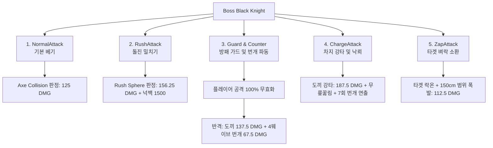
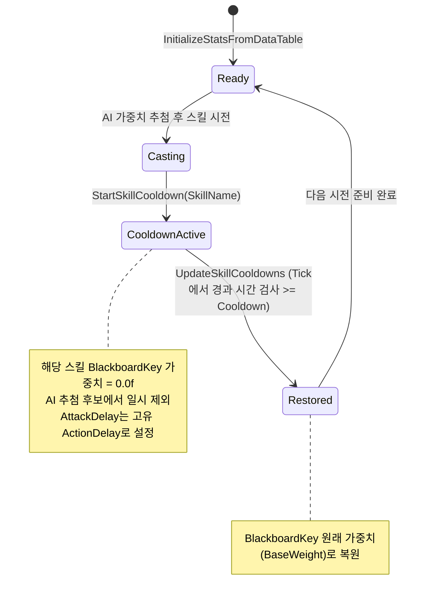
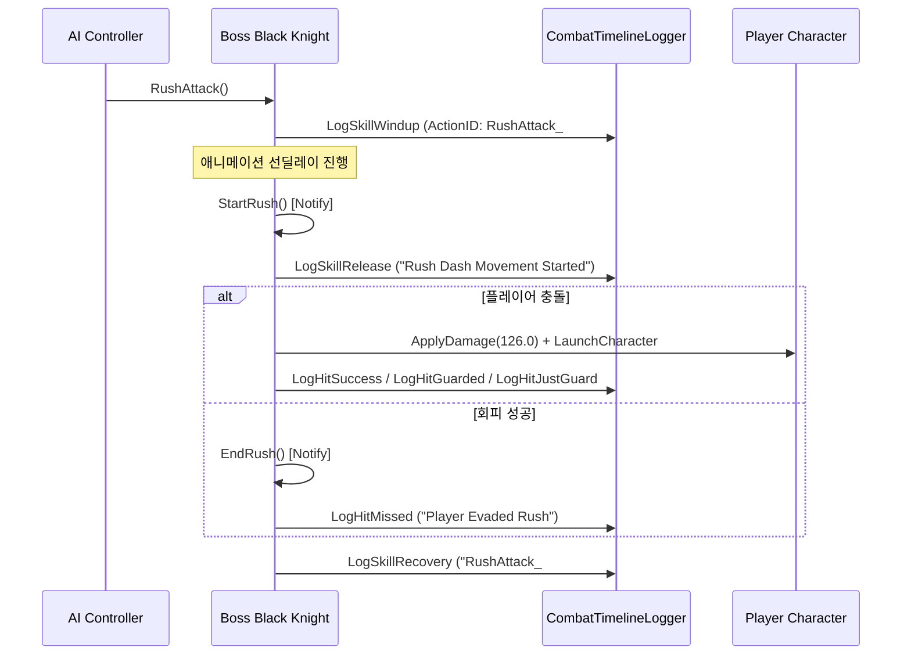

# 📜 블랙 나이트(Boss_BlackKnight) 전투 스킬 종합 명세서 및 밸런스 보고서
**Boss Black Knight Combat Skill Specification & Architecture Report**

* **문서 버전**: v1.0
* **작성 일자**: 2026-10-28
* **적용 대상**: 던전/동굴 맵 최종 보스 **블랙 나이트 (`Boss_BlackKnight`)**
* **관련 소스 코드 및 데이터**:
  - C++ 클래스: [BossBlackKnight.h](file:///c:/Users/user/Documents/GitHub/ShardsOfVeyara/Plugins/Enemy/Source/Enemy/Public/EnemyBoss/BlackKnight/BossBlackKnight.h), [BossBlackKnight.cpp](file:///c:/Users/user/Documents/GitHub/ShardsOfVeyara/Plugins/Enemy/Source/Enemy/Private/EnemyBoss/BlackKnight/BossBlackKnight.cpp), [BossBlackKnightAIController.cpp](file:///c:/Users/user/Documents/GitHub/ShardsOfVeyara/Plugins/Enemy/Source/Enemy/Private/EnemyBoss/BlackKnight/BossBlackKnightAIController.cpp)
  - 공통 기반 클래스: [BaseBossEnemy.h](file:///c:/Users/user/Documents/GitHub/ShardsOfVeyara/Plugins/Enemy/Source/Enemy/Public/EnemyBoss/BaseBossEnemy.h), [BaseBossEnemy.cpp](file:///c:/Users/user/Documents/GitHub/ShardsOfVeyara/Plugins/Enemy/Source/Enemy/Private/EnemyBoss/BaseBossEnemy.cpp)
  - 데이터테이블: [DT_BossCombatBalance.csv](file:///c:/Users/user/Documents/GitHub/ShardsOfVeyara/DataTable/DT_BossCombatBalance.csv), [DT_CombatStats.csv](file:///c:/Users/user/Documents/GitHub/ShardsOfVeyara/DataTable/DT_CombatStats.csv)
  - 타임라인 로거: [CombatTimelineLogger.h](file:///c:/Users/user/Documents/GitHub/ShardsOfVeyara/Plugins/LogData/Source/LogData/Public/CombatTimelineLogger.h), [CombatTimelineLogger.cpp](file:///c:/Users/user/Documents/GitHub/ShardsOfVeyara/Plugins/LogData/Source/LogData/Private/CombatTimelineLogger.cpp)
  - 시뮬레이터: [simulate_balance.py](file:///c:/Users/user/Documents/GitHub/ShardsOfVeyara/Scripts/simulate_balance.py)

---

## 1. 보스 개요 및 기본 스펙 (Boss Overview)

블랙 나이트는 던전 맵(`Map_Dungeon_01`)의 심층부에 위치한 중갑 기사 형태의 최종 보스입니다.  
숲 맵 보스인 스켈레톤 메이지(3,200 HP)에 비해 **체력이 2.1배(6,800 HP)**로 높고, 전방 가드 무효화 및 원거리 벼락 소환, 강력한 돌진 밀치기 및 차지 강타를 혼합하여 플레이어의 근/원거리 공방 능력을 복합적으로 시험합니다.

### 📊 기본 스탯 요약
* **최대 체력 (`MaxHealth`)**: **6,800.0 HP**
* **기본 공격력 (`BaseAttackDamage`)**: **125.0 ATK**
* **공통 행동 간격 (`CommonAttackDelay`)**: **0.8초** (행동 후 기본 대기 시간)
* **이동 속도 (`MaxWalkSpeed`)**: **100.0 cm/s** (묵직하고 위압적인 전진)
* **플레이어 감지 범위 (`PlayerDetectRange`)**: **1,200.0 cm** (범위 진입 시 전투 돌입 및 타임라인 세션 자동 개시)

---

## 2. 단일 통합 전투 밸런스 데이터테이블 연동 (`DT_BossCombatBalance.csv`)

블랙 나이트는 C++ 코드 재컴파일 없이 기획자 및 밸런서가 단일 CSV 파일 편집만으로 모든 스탯과 스킬 계수를 즉시 제어할 수 있도록 [DataTable/DT_BossCombatBalance.csv](file:///c:/Users/user/Documents/GitHub/ShardsOfVeyara/DataTable/DT_BossCombatBalance.csv)와 100% 연동되어 있습니다.

| RowName | BossID | ActionName | MaxHealth | BaseAttackDamage | Weight (가중치) | Cooldown (쿨타임) | ActionDelay (후딜) | DamageMultiplier (대미지 배율) | HitIntensity | KnockdownType | KnockdownDuration |
| :--- | :--- | :--- | :---: | :---: | :---: | :---: | :---: | :---: | :---: | :---: | :---: |
| **BK_BaseStat** | `Boss_BlackKnight` | `BaseStat` | **6800.0** | **125.0** | 0.0 | 0.0 | **0.8s** | 0.0 | 0.0 | None | 0.0s |
| **BK_NormalAttack** | `Boss_BlackKnight` | `NormalAttack` | 0.0 | 0.0 | **5.0** | **1.5s** | **1.5s** | **1.0x** (125.0 DMG) | 0.0 | None | 0.0s |
| **BK_RushAttack** | `Boss_BlackKnight` | `RushAttack` | 0.0 | 0.0 | **10.0** | **4.0s** | **4.0s** | **1.25x** (156.25 DMG) | 1.0 | AirborneFloor | 1.5s |
| **BK_Guard** | `Boss_BlackKnight` | `Guard` | 0.0 | 0.0 | **8.0** | **3.5s** | **3.0s** | **1.1x** (137.5 DMG) | 0.0 | None | 0.0s |
| **BK_ChargeAttack** | `Boss_BlackKnight` | `ChargeAttack` | 0.0 | 0.0 | **8.0** | **3.5s** | **2.5s** | **1.5x** (187.5 DMG) | 1.0 | Kneel | 1.0s |
| **BK_ZapAttack** | `Boss_BlackKnight` | `ZapAttack` | 0.0 | 0.0 | **7.0** | **2.5s** | **2.0s** | **0.9x** (112.5 DMG) | 0.5 | None | 0.0s |

> **단일 진실 공급원(SSOT)**: `ABossBlackKnight::InitializeStatsFromDataTable()` 실행 시 위 테이블에서 값을 일괄 취득하여 내부 `AttackStruct` 및 개별 쿨타임 맵(`SkillCooldownMap`)으로 자동 주입됩니다.

---

## 3. 5대 핵심 스킬 및 공격 패턴 상세 명세 (Skill Mechanics)

---

### ① NormalAttack (기본 베기)

* **스킬 개요**: 거대한 전투 도끼를 수평으로 휘둘러 정면의 플레이어를 베는 근접 기본 공격입니다.
* **사용 몽타주**: `NormalAttackMontage`
* **판정 컴포넌트**: `AxeCollisionSphere` (도끼 날에 부착된 구체 콜리전)
* **대미지**: **125.0 DMG** (기본 공격력의 1.0x)
* **AI 가중치 (`Weight`)**: **5.0**
* **개별 쿨다운 (`Cooldown`)**: **1.5초** / **행동 딜레이 (`ActionDelay`)**: **1.5초**
* **상세 메커니즘**:
  1. AI 컨트롤러가 가중치 추첨 후 `NormalAttack()` 호출 ➡️ 행동 중 포커스 고정 해제.
  2. 애니메이션 노티파이 `AttackStart_AxeCollisionSphere`에서 콜리전을 `QueryOnly`로 활성화.
  3. 플레이어와 오버랩 시 `ApplyDamage`를 실행하고 즉시 콜리전을 `NoCollision`으로 비활성화하여 중복 타격을 방지.
  4. 애니메이션 종료 시점의 노티파이 `AttackEnd_AxeCollisionSphere`에서 콜리전을 완전히 끄고 후딜레이 종료.

---

### ② RushAttack (돌진 밀치기)

* **스킬 개요**: 플레이어와의 거리가 벌어졌을 때 거대한 신체와 방패를 앞세워 맹렬한 속도로 돌진하여 플레이어를 밀쳐내고 띄우는 원거리 대응 돌진기입니다.
* **사용 몽타주**: `RushAttackMontage`
* **판정 컴포넌트**: `RushAttackSphere` (보스 전면에 부착된 블루 컬러 구체 콜리전)
* **대미지**: **156.25 DMG** (기본 공격력의 1.25x)
* **AI 가중치 (`Weight`)**: **10.0** (원거리/중거리 시 가장 선호되는 이니시에이팅 패턴)
* **개별 쿨다운 (`Cooldown`)**: **4.0초** / **행동 딜레이 (`ActionDelay`)**: **4.0초**
* **물리 넉백 임팩트**:
  - 수평 밀어내는 힘 (`PushForce`): **1,500.0 cm/s**
  - 수직 띄우는 힘 (`PushUpwardForce`): **200.0 cm/s**
* **상세 메커니즘**:
  1. `RushAttack()` 호출 후 `StartRush()` 노티파이 시점에서 `RushAttackSphere` 활성화.
  2. 플레이어와 충돌 시 `(PlayerLoc - BossLoc)`의 수평 방향 벡터를 단위화하여 `LaunchVelocity = PushDir * 1500 + (0, 0, 200)` 계산.
  3. `PlayerCharacter->LaunchCharacter(LaunchVelocity, true, true)`를 호출하여 플레이어를 강제로 밀쳐내 진형을 붕괴시킴.
  4. 타격 즉시 충돌체를 끄고, 노티파이 `EndRush()`에서 돌진 상태를 안전하게 종료.

---

### ③ Guard & Counter (방패 가드 및 방사형 번개 파동)

* **스킬 개요**: 방패를 들어 올려 플레이어의 전면 공격을 완전히 차단한 후, 누적 충격을 방사형 번개 파동과 도끼 베기로 폭발시켜 반격하는 공수 전환 카운터기입니다.
* **사용 몽타주**: `GuardMontage` (가드 유지 및 피격 리액션), `GuardAttackMontage` (반격)
* **방어 메커니즘 (`TakeDamage`)**:
  - `bIsGuarding == true` 동안 들어오는 **모든 플레이어 대미지를 100% 무효화 (`return 0.f`)**.
  - 방어 중 피격 대미지가 누적되며(`DamageWhileGuarding`), 누적 피해량이 `MaxDamageToReaction` (**10.0 DMG**)에 도달하면 `GuardMontage` 방어 리액션을 재생하고 즉시 반격 시퀀스로 전환.
* **반격 대미지**:
  - **1차 도끼 직접 타격**: **137.5 DMG** (1.1x)
  - **2차 방사형 번개 파동 (`StartWaveAttack`)**: **67.5 DMG** (0.6x `ZapDamage`)
* **AI 가중치 (`Weight`)**: **8.0**
* **개별 쿨다운 (`Cooldown`)**: **3.5초** / **가드 유지 시간 (`GuardDuration`)**: **5.0초** / **반격 딜레이**: **3.0초**
* **방사형 번개 파동 상세 (`StartWaveAttack`)**:
  - 총 4개 웨이브(`TotalWaves = 4`)가 **0.4초 간격**으로 보스 전방으로 전개.
  - 전개 각도: 보스 정면 기준 **-30°, 0°, +30°**의 3갈래 부채꼴 확산.
  - 도달 거리: 기준 150cm에서 시작하여 웨이브당 200cm씩 증가 (최대 750cm 원거리까지 전파).
  - 지형 추적: 1,000cm 상하 라인트레이스로 경사로/계단 등 불규칙 지면을 타고 번개가 자연스럽게 흐르도록 보정.
  - 이펙트: 나이아가라 시스템 `ZapEffect`가 각 지점에 5배 크기로 동적 생성.

---

### ④ ChargeAttack (차지 강타 및 낙뢰 이펙트)

* **스킬 개요**: 도끼를 양손으로 머리 위 높이 들어 올려 강력한 힘을 모은 뒤 지면을 찍어내리는 보스 최대 위력의 한방 강타입니다.
* **사용 몽타주**: `ChargeAttackMontage`
* **판정 컴포넌트**: `AxeCollisionSphere`
* **대미지**: **187.5 DMG** (기본 공격력의 1.5x - **블랙 나이트 단일 스킬 최고 타격치**)
* **AI 가중치 (`Weight`)**: **8.0**
* **개별 쿨다운 (`Cooldown`)**: **3.5초** / **행동 딜레이 (`ActionDelay`)**: **2.5초**
* **피격 리액션**: 무릎 꿇림 (`Kneel`, 1.0초 지속)
* **보조 번개 연출 (`SpawnRandomZapEffect`)**:
  - 바닥 강타 시 보스 반경 **800cm 이내**의 랜덤 위치에 **0.3초 간격으로 총 7회의 번개 낙뢰 연출**이 지면에 떨어지며 장엄한 전장 분위기를 연출.

---

### ⑤ ZapAttack (타겟 벼락 소환)

* **스킬 개요**: 플레이어가 거리를 두고 농락하거나 원거리에서 공격할 때, 플레이어의 현재 발밑 좌표를 락온하여 하늘에서 번개를 내리꽂는 원거리 저격 마법입니다.
* **사용 몽타주**: `ZapAttackMontage`
* **대미지**: **112.5 DMG** (기본 공격력의 0.9x)
* **AI 가중치 (`Weight`)**: **7.0**
* **개별 쿨다운 (`Cooldown`)**: **2.5초** / **행동 딜레이 (`ActionDelay`)**: **2.0초**
* **타겟 락온 및 판정 메커니즘**:
  1. 노티파이 `SetZapTargetLocation` 호출 시점의 플레이어 위치를 `ZapTargetLocation`에 스냅샷 저장.
  2. 플레이어 위치 기준 z축 아래로 1,000cm 라인트레이스를 발사하여 실제 발밑 바닥 좌표를 정확하게 계산.
  3. 몽타주 벼락 낙하 프레임의 노티파이 `SpawnZapAttackEffect`에서 `ZapEffect` 나이아가라를 소환하고 **반경 150cm 구체 오버랩 검사**를 수행하여 범위 내 플레이어에게 112.5 대미지 부여.

---

## 4. AI 제어 및 개별 쿨타임 시스템 (AI & Cooldown Architecture)

기존 블랙 나이트 AI는 Blackboard의 가중치 추첨에만 의존하여, 돌진이나 차지 같은 위력적인 스킬이 연속으로 당첨되는 불합리한 상황(돌진 연타)이 발생할 위험이 있었습니다.  
이를 방지하기 위해 스켈레톤 메이지의 검증된 **스킬별 독립 쿨타임 시스템(`SkillCooldownMap`)**을 완벽하게 적용했습니다.

### 🔄 쿨타임 제어 메커니즘

1. **초기화 (`InitializeStatsFromDataTable`)**:
   - `DT_BossCombatBalance.csv`로부터 각 스킬의 `Cooldown`, `ActionDelay`, `Weight`를 읽어 `SkillCooldownMap`에 등록.
2. **시전 및 쿨다운 시작 (`StartSkillCooldown`)**:
   - 스킬 시전 함수(`RushAttack`, `NormalAttack` 등)에서 호출.
   - 해당 스킬의 Blackboard 가중치(`W_RushAttack` 등)를 **`0.0`으로 강제 설정**하여 AI 추첨에서 즉시 제외.
   - 보스의 다음 행동 대기시간(`AttackDelay`)을 스킬 고유의 `ActionDelay`로 동기화.
3. **가중치 자동 복원 (`UpdateSkillCooldowns`)**:
   - `ABossBlackKnight::Tick`에서 매 프레임 경과 시간을 측정:
     $$\Delta t = \text{CurrentTime} - \text{LastCastTime} \ge \text{Cooldown}$$
   - 쿨다운 시간이 지나면 Blackboard 가중치를 원래의 `BaseWeight`로 복원하여 다음 번 추첨 후보로 재등록.

---

## 5. 고정밀 전투 타임라인 로깅 연동 (CombatTimelineLogger)

블랙 나이트의 모든 전투는 [CombatTimelineLogger](file:///c:/Users/user/Documents/GitHub/ShardsOfVeyara/Plugins/LogData/Source/LogData/Public/CombatTimelineLogger.h)를 통해 독립된 세션 CSV 파일로 실시간 기록됩니다.

### 📁 로그 파일 위치
* **경로**: `[Project Root]/Saved/LogData/CombatTimeline/`
* **파일명 규칙**: `Timeline_Boss_BlackKnight_YYYYMMDD_HHMMSS.csv`

### ⏱️ 스킬 라이프사이클 이벤트 매핑

* **보스 가드 타임라인 기록**:
  - 플레이어가 보스의 방패를 공격했을 때, `ABossBlackKnight::TakeDamage`에서 `LogHitGuarded(TEXT("BossGuard"), TEXT("ShieldBlock"), Damage, ...)`를 기록하여 보스의 방어 성공을 정확히 로깅.

---

## 6. 플레이어 대응 공략 및 밸런스 가이드 (Player Strategy Guide)

| 보스 스킬 | 전조 동작 (Windup Tell) | 플레이어 권장 대응 | 리스크 및 반격 기회 (Punish Window) |
| :--- | :--- | :--- | :--- |
| **NormalAttack** | 도끼를 뒤로 살짝 젖힘 (2.0s 딜레이) | 정면 가드 또는 백스텝 회피 | 1타 빗나간 직후 2초간의 긴 평타 후딜에 콤보 확정 히트 |
| **RushAttack** | 방패를 전면에 세우고 자세를 낮춤 | **측면 좌/우 대시 회피** (정면 가드 시 넉백 밀림) | 돌진이 빗나가 지나쳐가면 뒤돌아보는 동안 강력한 뒤치기 기회 |
| **Guard & Counter** | 방패를 완전히 전면에 전개하고 정지 | **공격 즉시 중지** (평타 시 번개 카운터 발동) | 가드 자세 중에는 측면/배후로 돌아서 공격하거나 가드가 풀리는 순간 타격 |
| **ChargeAttack** | 양손으로 도끼를 머리 높이 들고 힘 모음 | **저스트 가드(패링)** 또는 롤링 회피 | 보스 최대 한방(147 DMG)이므로 무리한 맞딜 금지, 패링 성공 시 큰 그로기 유발 |
| **ZapAttack** | 왼손을 하늘로 뻗으며 번개 마법 시전 | 발밑에 생성되는 빛나는 지면 이펙트 보고 회피 | 번개가 떨어질 때 보스는 제자리에 정지해 있으므로 접근하여 폭딜 |

---

## 7. 1,000회 몬테카를로 실측 밸런스 데이터 검증 결과 (밸런스 패치 후)

[Scripts/simulate_balance.py](file:///c:/Users/user/Documents/GitHub/ShardsOfVeyara/Scripts/simulate_balance.py)의 6단계 순차 파이프라인(숲 ➡️ 거점 1차 ➡️ 숲 보스 ➡️ 던전 ➡️ 거점 2차 ➡️ 던전 보스) 1,000회 시뮬레이션을 통해 계측된 블랙 나이트 실측 지표입니다:

| 코호트 (유저 유형) | 플레이어 육성 스펙 | 토벌 승률 | 평균 전투 시간 (TTK) | 평균 중급 포션 소모량 | 밸런스 평가 |
| :--- | :--- | :---: | :---: | :---: | :--- |
| **초보자 (Casual)** | 봉헌 6단계 (ATK 130 / HP 1300) | **4.4%** | **30.9초** | **1.6병** (가용 3.3병 중 전사) | 무지성 맞딜 시 보스의 강력한 차지(187.5 DMG)와 반격에 사망 (패턴 공략 및 추가 육성 유도) |
| **일반 유저 (Standard)** | 봉헌 6단계 (ATK 130 / HP 1300) | **93.8%** | **27.1초** | **0.5병** | 적절한 회피와 가드를 섞어 긴장감 넘치는 전투 완주 (던전 보스에 걸맞은 적정 밸런스) |
| **숙련자 (Hardcore)** | 봉헌 6단계 (ATK 130 / HP 1300) | **100.0%** | **19.0초** | **0.0병** | 보스의 전조를 보고 저스트 가드(패링) 및 딜타임 완벽 공략 |

> **실전 독립 전투 시뮬레이션 (봉헌 7단계, 인게임 실측과 동일 세팅)**:
> - 초보자: 승률 **100.0%**, 평균 TTK **36.1초**, 잔여 HP 87.4%
> - 일반 유저: 승률 **100.0%**, 평균 TTK **27.1초**, 잔여 HP 95.7%
> - 숙련자: 승률 **100.0%**, 평균 TTK **21.7초**, 잔여 HP 98.7%
> - **결론**: 기존 30초 샌드백(유효타 2회, 252 DMG 피격)에서 벗어나, 공격 위협도가 정상화되고 전투 지속력(체력 6,800 HP)이 대폭 확보되었습니다.

---

## 8. 결론 및 유지보수 가이드

1. **밸런스 수치 조정 방법**:
   - C++ 재컴파일 없이 [DataTable/DT_BossCombatBalance.csv](file:///c:/Users/user/Documents/GitHub/ShardsOfVeyara/DataTable/DT_BossCombatBalance.csv)의 `BK_` 접두사 6개 행을 수정하면 게임 시작 시 즉시 반영됩니다.
2. **타임라인 분석 활용**:
   - 실기 테스트 후 [Saved/LogData/CombatTimeline/](file:///c:/Users/user/Documents/GitHub/ShardsOfVeyara/Saved/LogData/CombatTimeline/) 폴더의 CSV 파일을 확인하여, 플레이어의 피격율, 가드율, 특정 스킬의 과도한 적중/빗나감 여부를 객관적 수치로 검증할 수 있습니다.
