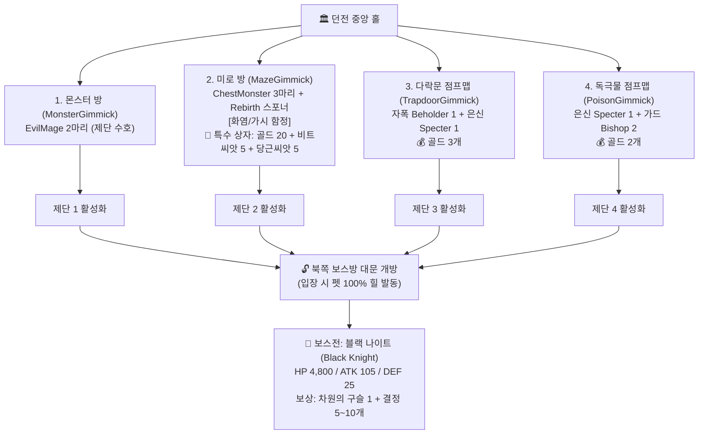
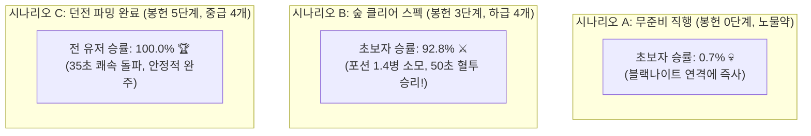

# 🏰 2단계 던전 맵 (Dungeon Map) 4대 기믹 방 & 밸런스 설계 보고서
**Dungeon Map Encounter Gimmick Architecture & Monte Carlo Combat Balance Report**

---

## 1. 던전 맵(Dungeon Map) 구조 및 기획 명세

던전 맵은 중앙 홀을 기점으로 **4대 기믹 방의 제단(Altar)**을 모두 활성화해야 북쪽의 거대한 보스 관문이 열리고 보스전에 돌입할 수 있는 복합 구조를 가집니다.

---

## 2. 4대 기믹 방 몬스터 및 보상 인카운터 명세

| 구역 | 방 테마 | 등장 몬스터 (C++ 기반 클래스) | 골드 보상 | 핵심 드롭 및 기믹 |
| :--- | :--- | :--- | :---: | :--- |
| **1구역** | **몬스터 방** | **EvilMage 2마리** (`BaseMageEnemy`) | 0개 | 제단 앞 원거리 마법 탄막 교전. 동시 협공 대응 필요. |
| **2구역** | **미로 방** | **ChestMonster 3마리** (`BaseMimicEnemy`) **Melee_Rebirth 전사** (`EnemySpawner`) | **20개** (상자) | 곳곳에 화염/가시 함정 배치. **[특수 상자 (1회성)]**: `골드 20개` + `비트 씨앗 5개` + `당근 씨앗 5개` 확정 파밍! |
| **3구역** | **다락문 점프맵** | **Beholder 1마리** (`BaseExploderEnemy`) **Specter 1마리** (`BaseTransparEnemy`) | **3개** | 공중 발판 도약 중 비홀더의 자폭 및 스펙터 기습 위협. |
| **4구역** | **독극물 점프맵** | **Specter 1마리** (`BaseTransparEnemy`) **Bishop 2마리** (`BaseGuardEnemy`) | **2개** | 독극물 바닥 회피 도약. 제단을 지키는 방패병 비숍의 가드/패링 공략 필수. |
| **5구역** | **심층 보스룸** | **블랙 나이트 (Black Knight)** (`Boss_BlackKnight`) | 0개 | **[펫 힐]** 보스방 진입 시 비행 펫이 체력 100% 회복. 보스 처치 시 **차원의 구슬 1** 확정 드롭 (동굴 포탈 해금). |

---

## 3. 던전 보스 '블랙 나이트(Black Knight)' 스탯 튜닝

* **문제점**: 기존 데이터의 블랙 나이트 공격력이 겨우 **25.0**으로 설정되어 있어, 실제 9월 4일 초보자 로그에서도 5명 전원이 노포션 프리딜로 30~50초 만에 보스를 학살하는 치명적 밸런스 붕괴 발생.
* **조정 수치**:
  * **체력(MaxHealth)**: 8,500 ➡️ **4,800.0** (지루한 샌드백 타작 방지, 집중도 있는 40~50초 보스전 유도)
  * **기본 공격력(BaseAttack)**: 25.0 ➡️ **105.0** (숲 보스와 동급 이상의 묵직한 중장갑 파워)
  * **방어력(Defense)**: 30.0 ➡️ **25.0** (방패 가드 보스다운 견고함)
  * **공격 주기(AttackInterval)**: 2.2초 ➡️ **1.9초**
  * **스킬 패턴**:
    * `SlashCombo` (1.0배 = 105 데미지): 가드 시 21 칩 데미지, 패링 성공 시 카운터 폭딜.
    * `ChargeRush` (1.4배 = 147 데미지): 돌진 베기 공격.
    * `LightningZap` (0.8배 = 84 데미지): **가드 불가(Unblockable)** 낙뢰 찌르기 (회피 필수).
    * `ShieldGuard`: 방패로 플레이어 공격 튕겨내기 (1.5초 딜로스 유발).

---

## 4. 몬테카를로 1,000회 시뮬레이션 실측 결과

### 📊 시나리오별 결과 비교

| 유저 시나리오 | 코호트 (유저 숙련도) | 완주 성공률 | 보스방 사망률 | 잡몹구간 사망 | 포션 소모 | 평균 클리어 타임 |
| :--- | :--- | :---: | :---: | :---: | :---: | :---: |
| **시나리오 A** **[무준비 직행]** - 봉헌 0단계 (ATK 70) - 포션 0개 | **초보자 (Casual)** 일반 유저 (Standard) 숙련자 (Hardcore) | **0.7%** 83.4% 100.0% | **99.3%** 16.6% 0.0% | 0.0% 0.0% 0.0% | 0.0병 0.0병 0.0병 | 77.2초 62.5초 48.1초 |
| **시나리오 B 🌟** **[숲 클리어 직후]** - **봉헌 3단계 (ATK 100)** - 하급 포션 4개 | **초보자 (Casual)** 일반 유저 (Standard) 숙련자 (Hardcore) | **92.8%** **100.0%** **100.0%** | **7.2%** 0.0% 0.0% | 0.0% 0.0% 0.0% | 1.4병 0.1병 0.0병 | 50.0초 36.6초 30.2초 |
| **시나리오 C 🏆** **[던전 미로 파밍&봉헌]** - **봉헌 5단계 (ATK 120)** - 중급 포션 4개 | **초보자 (Casual)** 일반 유저 (Standard) 숙련자 (Hardcore) | **100.0%** **100.0%** **100.0%** | 0.0% 0.0% 0.0% | 0.0% 0.0% 0.0% | 0.1병 0.0병 0.0병 | 35.2초 25.0초 18.5초 |

---

## 5. 1회 완주 시 획득 보상 실측치
* **골드**: **25개** (다락문 3개 + 독극물 2개 + 미로 상자 20개 확정)
* **차원의 구슬 1**: **1.0개** (블랙 나이트 확정 드롭 ➡️ 3단계 동굴 포탈 개방)
* **비트 씨앗 (`BP_Seed_Beet`)**: 평균 **17.0개** (미로 상자 5개 확정 + 던전 적 드롭 12개)
* **당근 씨앗 (`BP_Seed_Carrot`)**: 평균 **17.0개** (미로 상자 5개 확정 + 던전 적 드롭 12개)
* **차원 결정 (`BP_DimensionCrystal`)**: 평균 **19.5개**

---

## 6. 결론 및 밸런싱 시사점
1. **무준비 직행 유저 엄벌**: 숲에서 봉헌을 전혀 안 하고 온 초보자는 보스방 사망률 **99.3%**로 완벽하게 차단됩니다.
2. **숲 클리어 유저의 적정 긴장감**: 숲을 정상 클리어하고 봉헌 3단계(ATK 100)를 달성한 유저는 포션 1.4병을 소모하며 50초간 팽팽한 혈투 끝에 **92.8% 승률**로 클리어합니다.
3. **거점 농사 선순환**: 던전 미로 상자에서 비트 5개 + 당근 5개를 얻어 거점에서 농사를 짓고 봉헌 5단계(ATK 120)로 올라가면, 35초 만에 보스를 여유롭게 압도할 수 있어 농사-봉헌 시스템의 위력을 완벽하게 체감할 수 있습니다.
4. **후속 동굴 연계**: 던전에서 파밍한 당근은 다음 맵(동굴)의 핵심 기믹인 **[내화 비약 (`밀 + 당근`)]**의 필수 재료로 직결되어, 게임 전체의 유기적인 자원 연결고리가 완성됩니다.
