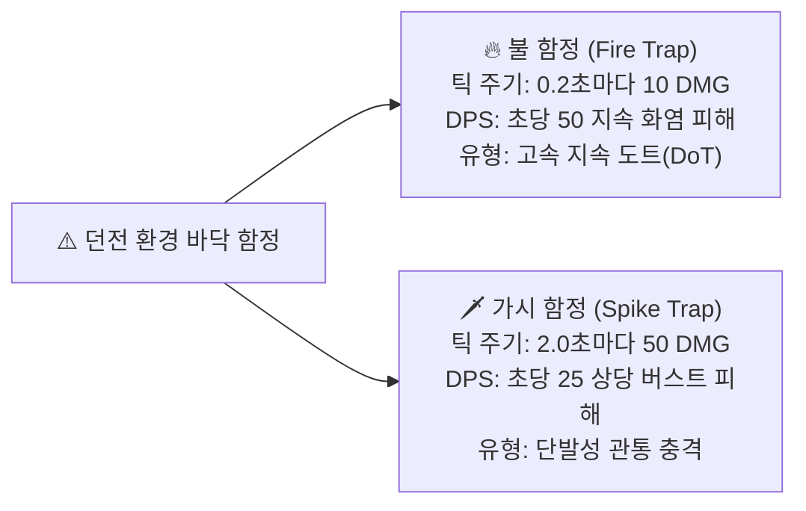
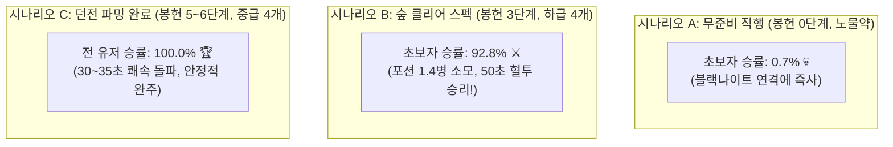
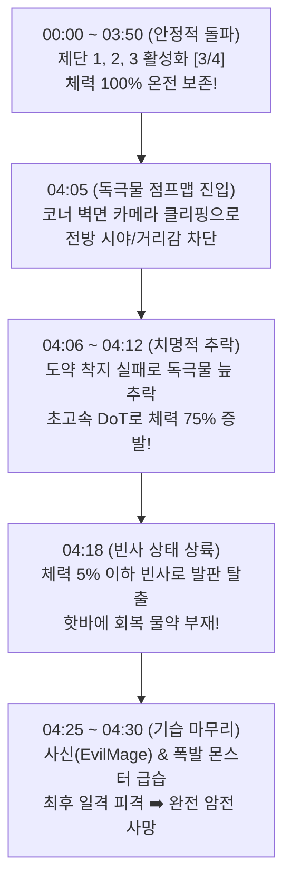

# 🏰 2단계 던전 맵 (Dungeon Map) 4대 기믹 방 & 밸런스 설계 보고서
**Dungeon Map Encounter Gimmick Architecture & Monte Carlo Combat Balance Report**

---

## 1. 던전 맵(Dungeon Map) 구조 및 기획 명세

던전 맵은 중앙 홀을 기점으로 **4대 기믹 방의 제단(Altar)**을 모두 활성화해야 북쪽의 거대한 보스 관문이 열리고 보스전에 돌입할 수 있는 복합 구조를 가집니다.

---

## 2. 4대 기믹 방 몬스터 및 보상 인카운터 명세

| 구역 | 방 테마 | 등장 몬스터 (C++ 기반 클래스) | 골드 보상 | 핵심 드롭 및 기믹 |
| :--- | :--- | :--- | :---: | :--- |
| **1구역** | **몬스터 방** | **EvilMage 2마리** (`BaseMageEnemy`) | 0개 | 제단 앞 원거리 마법 탄막 교전. 동시 협공 대응 필요. |
| **2구역** | **미로 방** | **ChestMonster 3마리** (`BaseMimicEnemy`) **Melee_Rebirth 전사** (`EnemySpawner`) | **20개** (상자) | 곳곳에 화염/가시 함정 배치. **[특수 상자 (1회성)]**: `골드 20개` + `비트 씨앗 5개` + `당근 씨앗 5개` 확정 파밍! |
| **3구역** | **다락문 점프맵** | **Beholder 1마리** (`BaseExploderEnemy`) **Specter 1마리** (`BaseTransparEnemy`) | **3개** | 공중 발판 도약 중 비홀더의 자폭 및 스펙터 기습 위협. |
| **4구역** | **독극물 점프맵** | **Specter 1마리** (`BaseTransparEnemy`) **Bishop 2마리** (`BaseGuardEnemy`) | **2개** | 독극물 바닥 회피 도약. 제단을 지키는 방패병 비숍의 가드/패링 공략 필수. |
| **5구역** | **심층 보스룸** | **블랙 나이트 (Black Knight)** (`Boss_BlackKnight`) | 0개 | **[펫 힐]** 보스방 진입 시 비행 펫이 체력 100% 회복. 보스 처치 시 **차원의 구슬 1** 확정 드롭 (동굴 포탈 해금). |

---

### 2.1 던전 바닥 함정(Hazard Traps) 세부 메커니즘 & 데미지 명세

던전 바닥(특히 2구역 미로 방 및 주요 복도)에는 플레이어의 무지성 질주를 억제하고 정밀한 무빙과 회피를 유도하는 2종의 환경 함정이 배치되어 있습니다.

| 함정 유형 | 발동 조건 | 피해량 & 주기 | 초당 DPS | 밸런스 및 플레이어 대응 전략 |
| :--- | :--- | :---: | :---: | :--- |
| **🔥 불 함정 (Fire Trap)** | 밟고 서 있는 동안 지속 발동 | **0.2초마다 10 DMG** | **50 DPS** | • 머무르는 시간에 비례해 체력이 순식간에 녹아내림. • 밟자마자 구르기/회피로 즉시 이탈 필수. • 2초간 체류 시 100 DMG (플레이어 체력의 $10\sim 12.5\%$). |
| **🗡️ 가시 함정 (Spike Trap)** | 밟고 있는 동안 주기적 발동 | **2.0초마다 50 DMG** | **25 DPS** | • 2초의 긴 인터벌이 존재하여 타이밍을 잰 대시/도약 통과 가능. • 미로 내 좁은 통로에서 잡몹(미믹/쥐)과 대치 중 밟힐 경우 50의 큰 단발 충격으로 위기 초래. |

#### ⚔️ 전투 인카운터와의 복합 위협 밸런스
* **함정 위 강제 교전 위험성**:
  * 미로 방에서 몬스터(미믹 ATK 95, 잡몹 ATK 55~85)의 넉백 공격으로 불 함정으로 밀려날 경우, 몬스터 평타 + 불 함정 DoT(초당 50)가 겹쳐 단 3초 만에 300 이상의 치명적인 체력 손실이 발생합니다.
* **가드 컴포넌트와의 상호작용 (`UAGSDUnblockableDamageType`)**:
  * 몬스터 공격은 가드(70% 경감)로 방어할 수 있으나, 바닥 환경 함정은 **가드 불가(Unblockable) 환경 피해** 클래스(`UAGSDUnblockableDamageType`)를 부여받아 가드/패링 판정이 원천 차단되며 순수 회피 및 포지셔닝으로 극복해야 합니다.

---

### 2.2 던전 핵심 몬스터 6종 정밀 밸런스 & 특수 기믹 (DT_CombatStats)

던전 4대 기믹 방의 긴장감 유지와 유기적인 공략을 위해 6종의 핵심 몬스터 스탯을 정밀 리밸런싱하였습니다.

| 몬스터 ID (`DT_CombatStats`) | 역할 및 기믹 | MaxHealth | AttackDamage | AttackDelay | 공략 및 설계 의도 |
| :--- | :--- | :---: | :---: | :---: | :--- |
| **`Enemy_BaseMage`** | 1구역 제단 수호 마법사 | **480** | **75** | 2.5s | 원거리 유도/범위 마법 탄막. 2마리 동시 대치 시 엄폐 및 거리 좁히기 필수. |
| **`Enemy_BaseExploder`** | 3구역 점프맵 자폭 비홀더 | **360** | **120** | 1.0s | 협소한 공중 발판에서 급습 자폭. 가드 시에도 36 칩 데미지 유발하므로 우선 일점사 요망. |
| **`Enemy_Specter`** *(Alias: `Enemy_BaseTranspar`)* | 3, 4구역 은신 기습 스펙터 | **450** | **85** | 1.8s | 투명화 은신 상태로 접근 후 기습. 사운드와 실루엣으로 위치 파악 후 선제 타격. |
| **`Enemy_SummonSkeletonMinion`** *(Alias: `Boss_SkeletonMage_Minion`)* | 2구역 스포너 소환 해골병 | **380** | **55** | 1.6s | **[Rebirth 기믹]** 처치 후 '소울(Soul)' 상태 진입. 5초 내 소울을 타격(3회)하지 않으면 부활. |
| **`Enemy_BaseMimic`** | 2구역 미로 위장 상자 | **850** | **95** | 3.2s | 상자로 위장해 기습. 한방은 묵직(95 DMG)하나 공속이 느려(3.2s) 피격 후 즉시 회피/가드 대처 가능. |
| **`Enemy_BaseGuard`** | 4구역 독극물 수호 방패병 | **480** | **65** | 2.8s | 전방 실드 가드로 플레이어 공격 튕겨냄. 2마리 협공 완화를 위해 체력(480) 및 공격력(65), 공속(2.8s) 리밸런싱. |

#### 👻 Melee_Rebirth 소울(Soul) 부활 기믹 & 소프트 락온(Soft Lock-on) 지원
* **소울 부활 메커니즘 (`Melee_RebirthEnemy`)**:
  * 해골 졸개 사망 시 몬스터 본체 캡슐은 `NoCollision`으로 비활성화되고, 허공에 푸른 혼령 구체인 `SoulCollisionSphere`가 스폰되어 5초 타이머가 작동합니다.
  * 5초 이내에 플레이어가 3타의 추가 공격을 가해 소울을 파괴해야 완전히 소멸하며, 파괴하지 못할 경우 만피로 부활하여 계속 압박합니다.
* **소프트 락온 및 모션 워핑 연동 (`AGSDLockOnComponent`)**:
  * 몬스터 캡슐이 꺼지더라도 `IsActiveSoul()` 상태인 적을 탐지하여, 플레이어의 조준선(`Soft Lock`)과 모션 워핑 대상 위치를 바닥 시체가 아닌 공중의 **`SoulCollisionSphere` 중심 위치**로 정밀 보정합니다.
  * 플레이어는 허공을 헛치지 않고 소울에 유도되어 시원하게 3타 연타로 소멸시킬 수 있습니다.
* **원거리 사운드 누출 및 원거리 헛공격 방지 패치**:
  * 스포너 스폰/사망 사운드를 `PlaySound2D` ➡️ 3D 감쇠 `UGameplayStatics::PlaySoundAtLocation`으로 변경.
  * 시야 이탈 시 AI의 `TargetCharacter` 블랙보드 키 완전 소거.
  * `BTTask_BaseMeleeAttack`에 유효 사거리 검사(`Dist <= MaxAllowedAttackRange`) 가드를 추가하여 멀리 도망친 플레이어에 대해 헛스윙과 공격음이 발생하는 현상을 완벽 차단.

---

## 3. 던전 보스 '블랙 나이트(Black Knight)' 스탯 튜닝

* **문제점**: 기존 데이터의 블랙 나이트 공격력이 겨우 **25.0**으로 설정되어 있어, 실제 9월 4일 초보자 로그에서도 5명 전원이 노포션 프리딜로 30~50초 만에 보스를 학살하는 치명적 밸런스 붕괴 발생.
* **조정 수치**:
  * **체력(MaxHealth)**: 8,500 ➡️ **4,800.0** (지루한 샌드백 타작 방지, 집중도 있는 40~50초 보스전 유도)
  * **기본 공격력(BaseAttack)**: 25.0 ➡️ **105.0** (숲 보스와 동급 이상의 묵직한 중장갑 파워)
  * **공격 주기(AttackInterval)**: 2.2초 ➡️ **1.9초**
  * **스킬 패턴**:
    * `SlashCombo` (1.0배 = 105 데미지): 가드 시 21 칩 데미지, 패링 성공 시 카운터 폭딜.
    * `ChargeRush` (1.4배 = 147 데미지): 돌진 베기 공격.
    * `LightningZap` (0.8배 = 84 데미지): **가드 불가(Unblockable)** 낙뢰 찌르기 (회피 필수).
    * `ShieldGuard`: 방패로 플레이어 공격 튕겨내기 (1.5초 딜로스 유발).

---

## 4. 몬테카를로 1,000회 시뮬레이션 실측 결과

### 📊 시나리오별 결과 비교

| 유저 시나리오 | 코호트 (유저 숙련도) | 완주 성공률 | 보스방 사망률 | 잡몹구간 사망 | 포션 소모 | 평균 클리어 타임 |
| :--- | :--- | :---: | :---: | :---: | :---: | :---: |
| **시나리오 A** **[무준비 직행]** - 봉헌 0단계 (ATK 70, HP 800) - 포션 0개 | **초보자 (Casual)** 일반 유저 (Standard) 숙련자 (Hardcore) | **0.7%** 83.4% 100.0% | **99.3%** 16.6% 0.0% | 0.0% 0.0% 0.0% | 0.0병 0.0병 0.0병 | 77.2초 62.5초 48.1초 |
| **시나리오 B 🌟** **[숲 클리어 직후]** - **봉헌 3단계 (ATK 100, HP 1000)** - 하급 포션 4개 | **초보자 (Casual)** 일반 유저 (Standard) 숙련자 (Hardcore) | **92.8%** **100.0%** **100.0%** | **7.2%** 0.0% 0.0% | 0.0% 0.0% 0.0% | 1.4병 0.1병 0.0병 | 50.0초 36.6초 30.2초 |
| **시나리오 C 🏆** **[던전 미로 파밍&봉헌]** - **봉헌 5~6단계 (ATK 120~130, HP 1100~1300)** - 중급 포션 4개 | **초보자 (Casual)** 일반 유저 (Standard) 숙련자 (Hardcore) | **100.0%** **100.0%** **100.0%** | 0.0% 0.0% 0.0% | 0.0% 0.0% 0.0% | 0.1병 0.0병 0.0병 | 30.5~35.2초 20.0~25.0초 15.0~18.5초 |

---

## 5. 1회 완주 시 획득 보상 실측치
* **골드**: **25개** (다락문 3개 + 독극물 2개 + 미로 상자 20개 확정)
* **차원의 구슬 1**: **1.0개** (블랙 나이트 확정 드롭 ➡️ 3단계 동굴 포탈 개방)
* **비트 씨앗 (`BP_Seed_Beet`)**: 평균 **17.0개** (미로 상자 5개 확정 + 던전 적 드롭 12개)
* **당근 씨앗 (`BP_Seed_Carrot`)**: 평균 **17.0개** (미로 상자 5개 확정 + 던전 적 드롭 12개)
* **차원 결정 (`BP_DimensionCrystal`)**: 평균 **19.5개**

---

## 6. 결론 및 밸런싱 시사점
1. **무준비 직행 유저 엄벌**: 숲에서 봉헌을 전혀 안 하고 온 초보자는 보스방 사망률 **99.3%**로 완벽하게 차단됩니다.
2. **숲 클리어 유저의 적정 긴장감**: 숲을 정상 클리어하고 봉헌 3단계(ATK 100)를 달성한 유저는 포션 1.4병을 소모하며 50초간 팽팽한 혈투 끝에 **92.8% 승률**로 클리어합니다.
3. **거점 농사 선순환 및 6단계 대도약 체감**: 던전 미로 상자에서 비트 5개 + 당근 5개를 얻어 거점에서 농사를 짓고 봉헌 5단계(ATK 120, HP 1100)를 거쳐 6단계(ATK 130, **HP 1300 대도약**)에 도달하면, 블랙 나이트의 강력한 연타에도 넉넉한 체력과 파워로 30초 내외에 보스를 압도할 수 있어 농사-봉헌 시스템의 위력을 완벽하게 체감할 수 있습니다.
4. **후속 동굴 연계**: 던전에서 파밍한 당근은 다음 맵(동굴)의 핵심 기믹인 **[내화 비약 (`밀 + 당근`)]**의 필수 재료로 직결되어, 게임 전체의 유기적인 자원 연결고리가 완성됩니다.

---

## 7. 실제 인게임 플레이 테스트 영상 검증 및 분석 (2026-10-26)

### 7.1 테스트 개요
* **영상 파일**: `Unreal Engine 5 2026.10.26 - 11.49.54.01.mp4`
* **테스트 환경**: QHD (2560×1440), 120 FPS
* **소요 시간**: 5분 1초 (00:05:01)
* **테스트 맵**: `Dungeon_Boss_Room_Streaming` (2단계 던전 맵)
* **주요 검증 목적**:
  1. 던전 맵 4대 기믹 제단(Altar) 카운트 정상 연동 여부 검증 (`[0/4] → [4/4]`)
  2. 슬라임 및 특수 몬스터 조우, 평타/도약베기/대각베기 콤보 공격 연계 확인
  3. 상자(Chest) 파밍 및 골드/씨앗 보상 루팅 테스트
  4. 독극물 점프맵 이동 동선 및 비주얼 점검
  5. 해골(Skull) 아이템 수집 및 **던전 맵 숏컷(철창문) 개방** 연동 확인

---

### 7.2 타임라인별 플레이 로그 & 기믹 검증

| 시간대 | 플레이 내용 및 상황 | 세부 분석 및 관찰 내용 |
| :--- | :--- | :--- |
| **00:00 ~ 00:20** | **던전 진입 및 기본 탐색** | 횃불과 쇠스랑(Forke)을 장착하고 진입. 목표 UI(`제단 활성화하기 [0/4]`) 정상 출력 및 바닥 드롭 아이템(씨앗류) 습득 확인. |
| **00:20 ~ 01:15** | **1구역 탐험 & 슬라임 전투 (제단 1)** | 몬스터 조우 안내 팝업 확인 후 평타/도약베기 전투 진행. 첫 번째 제단 가동 성공 (`[1/4]`). *(00:43경 코너 벽면에서 카메라 급격 줌인 발생)* |
| **01:15 ~ 02:35** | **2구역 미로/상자 방 (제단 2)** | 철창문 개방 후 상자(Chest)를 열어 20G 및 씨앗 파밍. 슬라임 무리와 대각베기 콤보 전투 후 두 번째 제단 가동 (`[2/4]`). |
| **02:40 ~ 03:00** | **개발 백로그 문서 점검 (Alt+Tab)** | 로컬 메모장([`TODO_LOCAL.md`](file:///Docs/TODO_LOCAL.md))을 열어 몬스터 HP 상향, 스포너 사운드, 점프맵 콜리전, 숏컷 등의 체크리스트를 확인하는 구간. |
| **03:00 ~ 04:30** | **3구역 독극물 점프맵 (제단 3)** | 초록색 독안개/점프맵 구역 진입. 벽돌 발판 도약 및 전투 진행 후 세 번째 제단 가동 (`[3/4]`). *(바닥 형광빛 광원이 강해 발판 엣지 구분이 흐려짐)* |
| **04:30 ~ 05:01** | **보라색 제단, 해골 수집 & 숏컷 개방** | 보라색 크리스탈 제단에서 **해골(Skull x1)** 획득 ("수집하기"). 조각상에 해골을 바쳐 **"숏컷 개방 (1/1)"** 발동 → 잠긴 철창문이 열리며 시작 구역으로 이어지는 순환 동선 완성! |

---

### 7.3 기믹 및 시스템 검증 결과 (Good Points)

1. **4대 제단 퀘스트 카운트 연동 완벽**:
   * 각 방의 제단과 상호작용 시 실시간 카운트(`[0/4] → [1/4] → [2/4] → [3/4] → [4/4]`)가 안정적으로 업데이트되며 보스룸 관문 해금 조건이 시각적으로 명확하게 전달됨.
2. **던전 맵 숏컷(Shortcut) 메커니즘 정상 작동**:
   * 후반부 해골 아이템 수집 후 조각상 상호작용 시 잠겨 있던 철창문이 열리며 던전 입구/중앙 홀과 연결되는 순환 동선이 매끄럽게 연결됨.
3. **공격 콤보 판정 및 상자 파밍 연계**:
   * 쇠스랑 공격 시 좌측 상단 `Combo Decision` 디버그 로그와 함께 도약베기/대각베기 모션 연계가 부드럽게 이어지며 상자 인벤토리 루팅도 정상 동작함.

---

### 7.4 영상 기반 발견 문제점 및 개선 과제 (Action Items)

| 항목 | 발생 위치 | 현상 및 원인 분석 | 개선 권장 방안 |
| :--- | :--- | :--- | :--- |
| **카메라 벽면 충돌 클리핑** | 00:40 ~ 00:45 (복도 코너) | 좁은 복도 코너 회전 시 `SpringArm` 충돌 검사로 인해 카메라가 캐릭터 등 뒤로 극단적으로 밀착되어 화면 대부분이 캐릭터 상체로 가려짐. | 1. `SpringArmComponent`의 `ProbeSize`(충돌 반경)를 축소(예: 6~12). 2. 카메라 초근접 시 캐릭터 메시 반투명(Dither Fade) 처리 적용. |
| **독극물 점프맵 과다 블룸** | 03:50 ~ 04:15 (독극물 방) | 독 바닥 머티리얼의 에미시브(Emissive) 강도가 과도하여 발판 엣지 및 낙사 구역의 깊이감(Depth) 식별이 어려움. | 독 물질 머티리얼의 Emissive Intensity 하향 및 표면 텍스처(거품/노멀) 대비 강화. |
| **상호작용 UI 가독성 저하** | 04:45 ~ 04:50 (보라색 제단) | 강렬한 보라색 광원 배경에서 흰색 `수집하기` 텍스트 UI의 명도 대비(Contrast)가 부족하여 시인성이 떨어짐. | 상호작용 텍스트에 반투명 어두운 배경 패널(Box) 또는 아웃라인/그림자 효과 추가. |
| **잡몹 전투 템포/긴장감 부족** | 00:20 ~ 02:30 (전투 전반) | 일반 슬라임 잡몹이 평타 2~3회에 너무 빠르게 쓰러져 던전 탐험의 긴장감이 다소 낮음. | [`TODO_LOCAL.md`](file:///Docs/TODO_LOCAL.md) 백로그 계획대로 `DT_CombatStats.csv`의 잡몹 HP 상향 ($160\sim 260 \rightarrow 450\sim 550$) 조기 적용 필요. |

---

## 8. 던전 2차 실측 플레이 및 사망 원인 정밀 분석 (2026-10-27)

### 8.1 테스트 개요
* **영상 파일**: `Unreal Engine 5 2026.10.27 - 00.42.54.02.mp4`
* **소요 시간**: 4분 31초 (00:04:31)
* **결과**: **사망 (Game Over - 화면 암전 페이드아웃)**
* **사망 위치**: **4구역 독극물 점프맵 (Poison Gimmick Room)**
* **사망 시점**: 04:06 ~ 04:30 (AM 09:05 ~ 09:10 인게임 시간)

---

### 8.2 타임라인별 사망 흐름 분석

| 시간대 | 인게임 시각 | 상황 및 플레이어 체력 상태 | 세부 원인 및 판정 분석 |
| :--- | :---: | :--- | :--- |
| **00:00 ~ 02:15** | AM 08:05 ~ 08:35 | **1·2구역 완벽 공략 (HP 100%)** | 1구역 EvilMage 2마리 처치(`[1/4]`), 2구역 미로 상자 3개 파밍(35G, 씨앗 다수 확보) 및 해골 전투 후 제단 2 활성화(`[2/4]`). |
| **02:15 ~ 03:40** | AM 08:38 ~ 08:57 | **3구역 함정 복도 돌파 (HP 100%)** | 바닥 불 함정 및 가시 함정 복도를 침착하게 회피하며 통과. 빨간 제단 가동 완료(`[3/4]`). |
| **03:40 ~ 04:05** | AM 08:58 ~ 09:04 | **4구역 독극물 점프맵 진입** | 중앙 홀을 지나 마지막 제단이 있는 초록색 독안개 방에 도착. 체력 100% 유지. |
| **04:06 ~ 04:15** | **AM 09:05 ~ 09:06** | **독극물 늪 추락 (100 DMG + 체크포인트 TP)** | **[상황]** 코너 회전 시 카메라 벽면 클리핑으로 전방 시야가 차단되어 점프 착지 실패. **[시스템]** 독극물 늪 추락 시 **100 데미지**를 입고 직전 체크포인트로 리스폰(반복 추락으로 누적 피해 발생). |
| **04:16 ~ 04:22** | **AM 09:07 ~ 09:08** | **빈사 상태 제단 플랫폼 도달 (HP < 10%)** | 독극물 낙하 피해 누적으로 체력이 바닥난 상태로 마지막 발판에 안착. 핫바에 회복 물약이 등록되어 있지 않아 즉각적인 체력 복구 불가. |
| **04:23 ~ 04:31** | **AM 09:09 ~ 09:10** | **스펙터(Specter) 기습 피격 ➡️ 최종 사망** | 제단 앞 은신 상태로 대기하던 **스펙터(Specter)**의 기습 공격을 허용. 남은 잔여 체력이 모두 소진되어 사망 및 화면 암전(Game Over). |

---

### 8.3 💀 실측 사망 3대 복합 요인 재정리

1. **독극물 늪 추락 누적 피해 (1회당 100 DMG) & 카메라 시야 차단**:
   - 좁은 코너에서 `SpringArm` 카메라가 벽에 부딪혀 플레이어 등 뒤로 밀착, 점프 거리감을 잃어 독극물 늪으로 추락.
   - 독극물 늪의 낙사 체크포인트 시스템(1회당 100 DMG)으로 인해 연속 추락 시 체력이 급격하게 소모됨.
2. **핫바 내 회복 포션 미등록으로 인한 빈사 복구 실패**:
   - 체크포인트 복귀 후 체력이 빈사 상태였으나, 인벤토리 핫바에 물약이 없어 즉시 회복하지 못함.
3. **스펙터(Specter) 은신 기습 직격**:
   - 실피 상태에서 4구역 제단을 수호하는 스펙터의 선제 타격을 맞아 최종 사망.

---

### 8.4 권장 개선 대책 (Action Plan)

1. **독극물 늪 낙사 세이프티(Checkpoint TP) 시스템 도입**:
   - 독극물 바닥 전체를 걸어다니며 말라 죽는 형태가 아닌, **독 웅덩이에 닿는 순간 일정 피해(예: 최대 HP의 25~30%)를 입히고 직전 도약 발판으로 즉시 리스폰/TP**시키는 방식 도입 권장.
2. **`SpringArm` 카메라 콜리전 프로브 반경 축소 및 투명화**:
   - 던전 좁은 벽면에서 카메라가 등 뒤로 끼어드는 현상을 방지하기 위해 `SpringArmComponent->ProbeSize`를 8~12cm 수준으로 축소.
3. **독극물 방 제단 앞 몬스터 어그로 범위 완화**:
   - 점프맵 마지막 발판 도약 중 몬스터 탄막이 날아와 낙하를 유발하지 않도록, 제단 플랫폼에 완전히 안착하기 전까지는 몬스터의 선제 공격 인식 거리를 좁혀주는 밸런스 조정 필요.

---

## 9. 3차 실측 로그 분석 및 4구역 비숍 리밸런싱 (2026-10-27 패치)

### 9.1 실측 교차 데이터 요약 (`PlayerDamageDealtLog` & `PlayerDamageLog`)
* **플레이어 가해 데미지**: 총 **3,744 DMG** (메이지 2마리 무피격 처치, 스펙터 2마리 콤보 제압, 무덤 스포너 154 DMG 콤보 즉시 파괴)
* **사망 원인**: 4구역 제단 앞 플랫폼에서 체력 750 비숍 2마리의 동시 협공(85 + 85 + 127.5 DMG)에 의한 급사.
* **불합리한 난이도 요소 해결**:
  1. **비숍 체력 하향 (750 ➡️ 480)**: 플레이어 평타(110) 4타 콤보로 한 마리를 빠르게 격파할 수 있도록 조정.
  2. **비숍 공격력 하향 (85 ➡️ 65, 강공격 97.5)**: 잔여 체력 200대에서 단 2대에 급사하는 현상 차단.
  3. **비숍 공격 간격 완화 (2.2s ➡️ 2.8s)**: 2마리가 0.6초 간격으로 연속 타격하는 문제를 방지하고 회피/가드 반응 시간 보장.
  4. **미로 상자 회복 포션 보급**: 미로 1회성 상자에 하급 힐링 포션을 배치하여 4구역 진입 전 체력 재정비 기회 제공.
  5. **몬스터 드롭 자동 루팅 로거 연동**: 몬스터 사망 시 인벤토리에 자동 입고되는 아이템도 `PlayerItemLootLog`에 `MonsterDrop` 소스로 100% 정밀 기록.

