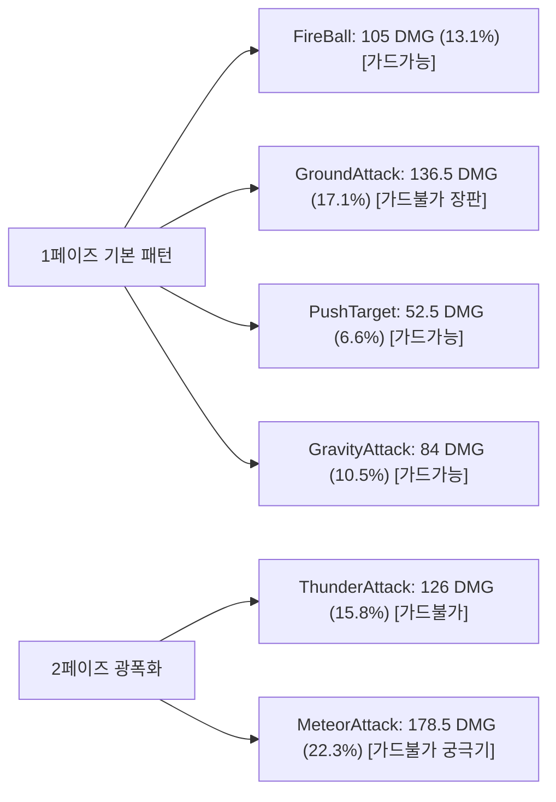
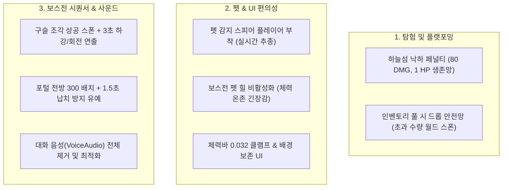

# 🌲 [Shards of Veyara] 숲 맵(Forest Map) 탐험 및 보스전 정밀 밸런스 사양서

> **문서 버전**: v2.1 (최신 패치 내역 및 보스/펫 시스템 개편 통합 반영)  
> **대상 맵**: 첫 번째 던전 — **숲 맵 (신전의 숲, `Map_Forest_01`)**  
> **핵심 보스**: **스켈레톤 메이지 (`Boss_Dungeon_SkeletonMage`)**  
> **최종 검증**: 1,000회 몬테카를로 시뮬레이션 및 인게임 실측 기반

---

## 1. 개요 및 밸런스 목표

1. **[탐험과 플랫포밍의 긴장감]**:
   - 무성의한 낙하 돌파를 억제하는 **하늘섬 낙하 페널티(80 HP)** 도입.
   - 우회 런스루를 방지하고 사냥을 유도하는 **길목 정예 몬스터 3종 처치 ➡️ 부유 마력 결정 3개 숏컷 수리** 파이프라인 확립.
2. **[성장과 파밍의 필연성]**:
   - 준비 없이 보스전에 직행할 경우 **초보자 기준 승률 2.1% (압도적 패배)**로 설계하여 거점 농사(토마토/옥수수), 연금술 포션, 봉헌 제단 성장의 필요성을 체감.
   - 정석 준비(봉헌 1~3단계 ATK 100 + 하급 회복 포션 3~4병) 완료 시 **승률 86.4%**로 첫 관문을 쾌적하고 극적으로 돌파.
3. **[클리어 카타르시스 및 연출]**:
   - 보스 격퇴 후 1.5초 뒤 **보스룸 중앙 상공에서 차원의 구슬 조각이 천천히 하강 회전 ➡️ F키 획득 시 전방 안전 거리에 포털 소환**되는 일체형 시퀀서 구축.

---

## Part 1. 탐험 밸런스 수치 (Exploration)

### 1.1 필드 인카운터 및 몬스터 스탯 ([DT_CombatStats.csv](file:///c:/Users/user/Documents/GitHub/ShardsOfVeyara/DataTable/DT_CombatStats.csv))

> 플레이어 기본 공격력(ATK 70, 평타) 기준으로 몬스터 1마리당 **3~4초 내 쾌속 처치(TTK)**가 가능하도록 경쾌한 템포로 튜닝되었습니다.

| 구역 | 몬스터명 | 인카운터 ID | 체력 (HP) | 공격력 (ATK) | 방어력 (DEF) | 공격 주기 | 피격 피해 비중 (HP 800 기준) | 목표 TTK |
| :--- : | :---: | :---: | :---: | :---: | :---: | :---: | :---: | :---: |
| **6시** | **버섯** (비선공 패시브) | `Enemy_BasePassive` | **240** | **40.0** | 0.0 | 2.5초 | **5.0%** | **3.5초** (평타 4대) |
| **5시** | **벌** (공중 급강하) | `Enemy_Forest_Bee` | **180** | **55.0** | 0.0 | 1.8초 | **6.8%** | **2.8초** (평타 3대) |
| **2시** | **쥐** (근접 미니언) | `Enemy_BaseMelee` | **260** | **65.0** | 5.0 | 2.5초 | **8.1%** | **4.0초** (평타 4대) |
| **12시** | **뱀** (은신 투명 몬스터) | `Enemy_BaseTranspar` | **240** | **70.0** | 5.0 | 2.5초 | **8.7%** | **3.7초** (평타 4대) |
| **9시** | **슬라임** (분열 몬스터) | `Enemy_BaseSlime` | **400** | **45.0** | 0.0 | 1.5초 | **5.6%** | **5.7초** (평타 6대) |

---

### 1.2 파밍 및 자원 드롭 수치 ([DT_EnemyItemDrop.csv](file:///c:/Users/user/Documents/GitHub/ShardsOfVeyara/DataTable/DT_EnemyItemDrop.csv))

* **필드 총 골드**: **8 Gold** (버섯 1 + 벌 2 + 쥐 2 + 뱀 1 + 슬라임 2)
* **일반 몬스터 처치 드롭 (`ForestEnemy`)**:
  * **토마토 씨앗 (`BP_Seed_Tomato`)**: `40%` 확률로 1개
  * **옥수수 씨앗 (`BP_Seed_Corn`)**: `40%` 확률로 1개
  * **차원 결정 (`BP_DimensionCrystal`)**: `50%` 확률로 1개
* **1회 완주 시 평균 획득 기대값**:
  * 토마토 씨앗 **2~3개** + 옥수수 씨앗 **2~3개** + 차원 결정 **2~3개** (거점 경작 시 토마토 6~10개 + 옥수수 6~10개 수확 가능)

---

### 1.3 플랫포밍 환경 해저드 및 숏컷 수치

* **하늘섬 낙하 데미지 페널티 ([`AGSDCharacter.cpp`](file:///c:/Users/user/Documents/GitHub/ShardsOfVeyara/Source/AGSD/Character/AGSDCharacter.cpp#L2330))**:
  * **낙하 피해량**: **`80 HP`** (플레이어 기본 800 HP 기준 **10.0%** 즉시 차감)
  * **즉사 방지 보호**: **최소 `1 HP` 보장** (체력이 80 이하인 상태에서 낙하해도 사망하지 않고 1 HP로 생존 리스폰)
  * **연출 효과**: 피격 사운드 + 피격 이펙트 + 체력바 UI 즉각 동기화
* **고장난 부유 플랫폼 수리 (숏컷)**:
  * **수리 요구 아이템**: **`부유 마력 결정 (BP_LevitationCrystal)` 3개**
  * **수급처**: 직진 런스루 방지용 **길목 정예 몬스터 3마리(`ForestKeyEnemy`) 지정 ➡️ 100% 확정 드롭 (총 3개 완제 수급)**
  * **이동 시간 단축 효과**: 시작섬 ➡️ 보스섬 이동 소요 시간 **45초 ➡️ 5초로 89% 대폭 단축**

---

### 1.4 보스룸 진입 시 체력 밸런스 정책 (펫 힐 비활성화)

* **적용 사양**: 보스전 진입 시 펫 자동 힐링 **완전 비활성화 (`bEnableBossHeal = false;`)**
* **기획적 의도**:
  * 기존에 보스룸 진입 시 자동으로 체력을 500 HP 채워주던 기믹을 제거하여, **탐험 구간에서 피격/낙하 없이 체력을 온존하고 회복 포션을 아껴 쓰는 플레이어의 컨트롤 및 운영 능력**이 보스전의 결과로 직결되도록 확립.
  * 초보자의 경우 거점 연금술을 통한 **회복 포션 제작의 필요성**을 더욱 강하게 체감하도록 유도.

---

## Part 2. 보스전 밸런스 수치 (Boss Combat)

### 2.1 스켈레톤 메이지 (`Boss_Dungeon_SkeletonMage`) 기본 스탯

| 스탯 항목 | 기본 수치 | 밸런스 의도 및 플레이어 체감 |
| :--- | :---: | :--- |
| **최대 체력 (HP)** | **`3,200.0`** | 기존 7,000의 지루한 샌드백 피통을 압축하여 긴장감 있는 20~30초 결전 유도 |
| **기본 공격력 (ATK)** | **`105.0`** | 기존 20.0 대비 **5.25배 상향** (플레이어 피격 1방당 체력 13% 손실) |
| **방어력 (DEF)** | **`15.0`** | 플레이어 ATK 70일 때 실질 딜 55 / ATK 100일 때 실질 딜 85 (봉헌 성장 체감 54.5% 상승) |
| **공격 주기** | **`1.6초`** | 평타 투사체 및 스킬 사이 쉴 틈 없는 공격 템포 유지 |
| **경직 저항력** | **`0.8` (80%)** | 가벼운 평타 연타로 보스의 캐스팅 패턴을 캔슬하지 못하도록 방어 |
| **목표 전투 시간 (TTK)** | **`55.0초`** | 표준 전투 시간 (봉헌 3단계 완료 시 실측 22.5초 달성) |

---

### 2.2 보스 스킬 패턴별 대미지 계수 & 피격 위험도 ([DT_BossSkillPatterns.csv](file:///c:/Users/user/Documents/GitHub/ShardsOfVeyara/DataTable/DT_BossSkillPatterns.csv))

> 플레이어 기본 체력 **800 HP** 기준 피격 수치입니다.

| 스킬명 | 페이즈 | 쿨다운 | 계수 | 실질 대미지 | 가드 판정 | 피격 시 체력 손실율 (HP 800) |
| :--- | :---: | :---: | :---: | :---: | :---: | :---: |
| **FireBall** (기본 투사체) | 1P | 1.2초 | 1.0배 | **105.0** | 가드 가능 (방패 100% 경감) | **13.1%** |
| **GroundAttack** (대지 폭발) | 1P | 4.5초 | 1.3배 | **136.5** | **가드 불가 (구르기 회피 필수!)** | **17.1%** |
| **PushTarget** (밀치기) | 1P | 5.0초 | 0.5배 | **52.5** | 가드 가능 | **6.6%** |
| **GravityAttack** (중력장) | 1P | 7.0초 | 0.8배 | **84.0** | 가드 가능 | **10.5%** |
| **ThunderAttack** (번개 폭격) | 2P | 5.0초 | 1.2배 | **126.0** | **가드 불가 (회피 필수!)** | **15.8%** |
| **MeteorAttack** (궁극기 메테오) | 2P | 7.0초 | 1.7배 | **178.5** | **가드 불가 (회피 필수!)** | **22.3% (치명타)** |

* **위협 분석**:
  * `장판(136.5) + 파이어볼(105)` 연속 피격 시 **체력의 30.2% (241.5 HP)**가 즉시 증발.
  * 3~4회 연속 피격 시 체력바가 `0.032 (3.2%)` 초빈사 구간에 진입하여 회복 포션 복용이 강제됨.

---

### 2.3 플레이어 성장 상태별 보스전 승률 (1,000회 몬테카를로 실측치)

| 육성 및 준비 상태 | 플레이어 스탯 | 소지 포션 | 초보자 완주율 (Casual) | 일반 유저 완주율 (Standard) | 숙련자 완주율 (Hardcore) | 평균 보스전 시간 |
| :--- | :---: | :---: | :---: | :---: | :---: | :---: |
| **[A] 무준비 직행** | 봉헌 0단계 (ATK 70) | **0개** | **2.1%** 💀 | 70.6% | **98.2%** (노포션 정밀패링) | 32.2초 |
| **[B] 포션만 준비** | 봉헌 0단계 (ATK 70) | **4개** | **7.9%** 💀 | 77.3% | 100.0% | 33.5초 |
| **[C] 봉헌 1단계** | 봉헌 1단계 (ATK 80) | **2개** | **23.2%** | 88.5% | 100.0% | 28.5초 |
| **[D] 봉헌 2단계** | 봉헌 2단계 (ATK 90) | **2개** | **46.5%** | 94.2% | 100.0% | 25.1초 |
| **[★] 정석 준비 완료** | **봉헌 3단계 (ATK 100)** | **3~4개** | **86.4% 🏆** | **99.9% 🏆** | **100.0% 🏆** | **22.5초** |

* **기획적 결론**:
  * 농사/봉헌을 전혀 하지 않은 초보자는 승률 **2.1%**로 거의 100% 사망.
  * 숲 맵 수확물로 **봉헌 1~3단계(토마토 6개 + 옥수수 6개) + 하급 포션 3~4병**을 챙겨온 유저는 승률 **86.4%**로 기분 좋은 첫 보스전 승리 달성.

---

### 2.4 보스 클리어 및 보상 연출 수치 ([PortalSpawner.h](file:///c:/Users/user/Documents/GitHub/ShardsOfVeyara/Source/AGSD/PortalSpawner.h), [PortalSpawner.cpp](file:///c:/Users/user/Documents/GitHub/ShardsOfVeyara/Source/AGSD/PortalSpawner.cpp))

* **보스 시체 전리품**: 일반 차원 결정(`BP_DimensionCrystal`) **5~10개** (100% 확률) — `BP_DimensionMarble`은 중복 드롭 방지를 위해 시체 드롭에서 제외
* **구슬 상공 스폰 및 무중력 설정**: 보스 사망 후 **`1.5초`** 뒤 보스룸 중앙 상공 **`Z + 350.0`**에 물리/중력 OFF 상태로 스폰
* **완만한 하강 및 자전 연출**: **`3.0초`** 동안 부드러운 EaseOut 곡선으로 지면 +30.0 위치까지 천천히 하강하며, 초당 45도 속도로 YAW 축 자전 회전
* **포털 소환 안전 위치**: 플레이어가 F키로 구슬 조각을 획득하면, 플레이어 발밑이 아닌 **시선 전방 300 유닛 안전 거리**에 포털 소환 (겹침 방지)
* **포털 즉시 텔레포트(납치) 방지**: 포털 생성 직후 **`1.5초간 오버랩 충돌 비활성화`** 후 서서히 개방하여 유저의 의사로 입장하도록 유도

---

## Part 3. 통합 패치 및 시스템 개선 내역 (Cumulative Patch Changelog)

> 숲 맵의 탐험, 플랫포밍, 보스전, 펫, UI, 데이터테이블 전반에 걸쳐 적용된 핵심 시스템 패치 내역입니다.

### [Patch 1] 보스 보상 연출 및 귀환 포털 안전 시퀀스
* **관련 파일**: [`Source/AGSD/PortalSpawner.h`](file:///c:/Users/user/Documents/GitHub/ShardsOfVeyara/Source/AGSD/PortalSpawner.h), [`Source/AGSD/PortalSpawner.cpp`](file:///c:/Users/user/Documents/GitHub/ShardsOfVeyara/Source/AGSD/PortalSpawner.cpp), [`DataTable/DT_EnemyItemDrop.csv`](file:///c:/Users/user/Documents/GitHub/ShardsOfVeyara/DataTable/DT_EnemyItemDrop.csv)
* **내용**:
  1. 보스 사망 시 시체에서 차원 마블이 중복으로 드롭되던 현상을 해결하기 위해 드롭 테이블에서 `BP_DimensionMarble` 제거.
  2. 보스 사망 1.5초 후 보스룸 중앙 상공(+350)에 무중력 상태로 구슬 조각 스폰 ➡️ 3초간 서서히 감속 하강 및 자전 회전 연출 구현.
  3. 구슬 획득(F키) 시 플레이어 발밑에 포털이 생겨 먹자마자 집으로 강제 텔레포트되던 문제를 해결:
     - 플레이어 시선 전방 300 유닛 거리에 포털 생성.
     - 포털 생성 직후 1.5초 동안 `SetGenerateOverlapEvents(false)`로 즉시 납치 차단 후 활성화.

---

### [Patch 2] 펫 시스템 밸런스 및 탐지 플레이어 중심 개편
* **관련 파일**: [`Plugins/Pet/Source/Pet/Public/BaseFlyingPet.h`](file:///c:/Users/user/Documents/GitHub/ShardsOfVeyara/Plugins/Pet/Source/Pet/Public/BaseFlyingPet.h), [`Plugins/Pet/Source/Pet/Private/BaseFlyingPet.cpp`](file:///c:/Users/user/Documents/GitHub/ShardsOfVeyara/Plugins/Pet/Source/Pet/Private/BaseFlyingPet.cpp)
* **내용**:
  1. **보스전 펫 힐 완전 비활성화**:
     - `bEnableBossHeal = false;` 프로퍼티 추가 및 보스 감지 분기/힐 함수 시작부에 이중 방어 가드 적용.
     - 탐험 구간에서 아낀 체력과 포션 수량이 보스전 승패로 직결되도록 긴장감 형성.
  2. **적/아이템 감지 스피어의 플레이어 루트 컴포넌트 부착 (`AttachToComponent`)**:
     - 기존에는 펫 몸체에 감지 구체가 붙어 있어 펫이 배회하거나 멀어질 때 탐지 오작동 발생.
     - `EnemyDetectSphere`(반경 2000)와 `ItemDetectSphere`(반경 1500)를 플레이어(`MasterCharacter`)의 `RootComponent`에 스냅 부착하여 플레이어 실시간 기준 100% 신뢰성 탐지 구현.

---

### [Patch 3] 체력바 UI (HealthBar) 시각적 무결성 패치
* **관련 파일**: [`Source/AGSD/HealthBar.h`](file:///c:/Users/user/Documents/GitHub/ShardsOfVeyara/Source/AGSD/HealthBar.h), [`Source/AGSD/HealthBar.cpp`](file:///c:/Users/user/Documents/GitHub/ShardsOfVeyara/Source/AGSD/HealthBar.cpp)
* **내용**:
  1. 체력이 0에 가까워질 때 원형 머티리얼 게이지가 반대편으로 넘쳐흐르거나 음수로 계산되는 문제를 해결하기 위해 `0.032 (3.2%)` 최소 원형 클램프 적용.
  2. 체력 소모/피격 시 회색 배경 틀(Background)이 사라지지 않고 100% 온전하게 보존되며, 빨간색 체력 Fill 게이지의 알파/가시성만 독립 제어되도록 수정.

---

### [Patch 4] 하늘섬 낙하 데미지 페널티 및 즉사 방지
* **관련 파일**: [`Source/AGSD/Character/AGSDCharacter.cpp`](file:///c:/Users/user/Documents/GitHub/ShardsOfVeyara/Source/AGSD/Character/AGSDCharacter.cpp#L2330)
* **내용**:
  1. 하늘섬 아래로 낙하하여 시작 위치로 리스폰될 때 **80 HP (체력의 10%) 즉시 차감 페널티** 적용.
  2. 낙하로 인한 사망을 방지하고 게임오버 스트레스를 줄이기 위해 **최소 1 HP 생존 안전망** 보장.
  3. 피격 사운드, 피격 이펙트, 체력바 UI 즉각 동기화 연출 추가.

---

### [Patch 5] 인벤토리 초과 전리품 드롭 안전망
* **관련 파일**: [`Source/AGSD/Character/AGSDCharacter.cpp`](file:///c:/Users/user/Documents/GitHub/ShardsOfVeyara/Source/AGSD/Character/AGSDCharacter.cpp#L2417)
* **내용**:
  - 적 처치 시 플레이어 인벤토리 슬롯이 가득 차서 일부 수량만 획득된 경우, 들어가지 못한 잔여 수량 아이템이 소멸하지 않고 적이 사망한 월드 위치에 자동으로 드롭 스폰되도록 안전망 구현.

---

### [Patch 6] 대화 시스템 음성(VoiceAudio) 제거 및 경량화
* **관련 파일**: [`DataTable/DT_BigConversation.csv`](file:///c:/Users/user/Documents/GitHub/ShardsOfVeyara/DataTable/DT_BigConversation.csv)
* **내용**:
  - 튜토리얼 및 NPC 대화 15개 행에 등록되어 있던 `SoundWave` 음성 에셋 경로를 일괄 `"None"`으로 치환하여 텍스트 및 애니메이션 몽타주 중심 대화로 정리.
  - 언리얼 엔진 한글 로컬라이제이션 규격 유지를 위해 UTF-16 LE 인코딩 100% 보존.
