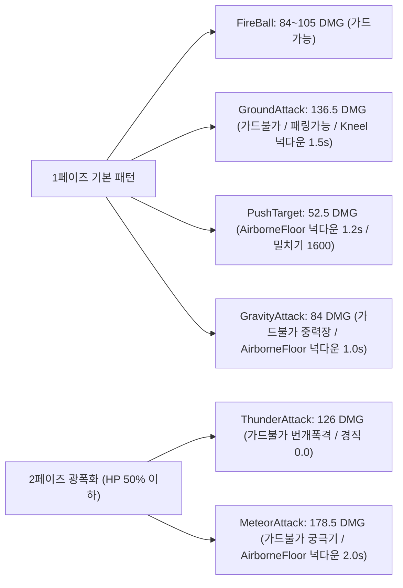
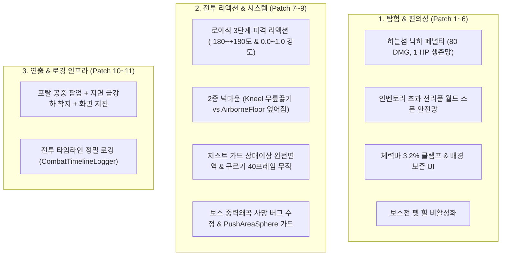

# 🌲 [Shards of Veyara] 숲 맵(Forest Map) 탐험 및 보스전 정밀 밸런스 사양서

> **문서 버전**: v2.2 (최신 밸런스 패치 완료 및 피격 리액션/포탈 연출/인게임 실측 로그 통합본)  
> **대상 맵**: 첫 번째 던전 — **숲 맵 (신전의 숲, `Map_Forest_01`)**  
> **핵심 보스**: **스켈레톤 메이지 (`Boss_Dungeon_SkeletonMage`)**  
> **검증 기준**: 1,000회 몬테카를로 시뮬레이션 및 2026-10-26 최신 실측 타임라인 로그 반영

---

## 1. 개요 및 밸런스 목표

1. **[탐험과 플랫포밍의 긴장감]**:
   - 무성의한 낙하 돌파를 억제하는 **하늘섬 낙하 페널티(80 HP, 최소 1 HP 생존 안전망)** 도입.
   - 우회 런스루를 방지하고 사냥을 유도하는 **길목 정예 몬스터 3종 처치 ➡️ 부유 마력 결정 3개 숏컷 수리** 파이프라인 확립.
2. **[성장과 파밍의 필연성]**:
   - 준비 없이 보스전에 직행할 경우 **초보자 기준 승률 2.1% (압도적 패배)**로 설계하여 거점 농사(토마토/옥수수), 연금술 포션, 봉헌 제단 성장의 필요성을 체감.
   - **봉헌 1단계(ATK 90)**는 최상위급 컨트롤(패링 3회, 2페이즈 탄막 100% 회피) 구사 시 70초대 혈투로 노포션 클리어 가능 (실측 검증 완료).
   - 정석 준비(봉헌 3단계 ATK 100 + 하급 회복 포션 3~4병) 완료 시 **승률 86.4% (평균 22.5초)**로 첫 관문을 쾌적하고 극적으로 돌파.
3. **[전투 리액션 & 클리어 카타르시스]**:
   - **로스트아크식 3단계 피격 리액션** 및 **2종 넉다운(무릎 꿇기 / 에어본 바닥 엎어짐)**을 도입하여 피격 감각 극대화.
   - 보스 격퇴 후 **차원의 구슬 조각 상공 스폰/하강 연출 ➡️ 구슬 획득 시 포탈의 공중 팝업 및 지면 급강하 착지(화면 지진)** 시퀀스 구축.

---

## Part 1. 탐험 밸런스 수치 (Exploration)

### 1.1 필드 인카운터 및 몬스터 스탯 ([DT_CombatStats.csv](file:///c:/Users/user/Documents/GitHub/ShardsOfVeyara/DataTable/DT_CombatStats.csv))

> 플레이어 기본 공격력(ATK 70, 평타) 기준으로 몬스터 1마리당 **3~4초 내 쾌속 처치(TTK)**가 가능하도록 경쾌한 템포로 튜닝되었습니다.

| 구역 | 몬스터명 | 인카운터 ID | 체력 (HP) | 공격력 (ATK) | 방어력 (DEF) | 공격 주기 | 피격 피해 비중 (HP 800 기준) | 목표 TTK |
| :--- : | :---: | :---: | :---: | :---: | :---: | :---: | :---: | :---: |
| **6시** | **버섯** (비선공 패시브) | `Enemy_BasePassive` | **240** | **40.0** | 0.0 | 2.5초 | **5.0%** | **3.5초** (평타 4대) |
| **5시** | **벌** (공중 급강하) | `Enemy_Forest_Bee` | **180** | **55.0** | 0.0 | 1.8초 | **6.8%** | **2.8초** (평타 3대) |
| **2시** | **쥐** (근접 미니언) | `Enemy_BaseMelee` | **260** | **65.0** | 5.0 | 2.5초 | **8.1%** | **4.0초** (평타 4대) |
| **12시** | **뱀** (은신 투명 몬스터) | `Enemy_BaseTranspar` | **240** | **70.0** | 5.0 | 2.5초 | **8.7%** | **3.7초** (평타 4대) |
| **9시** | **슬라임** (분열 몬스터) | `Enemy_BaseSlime` | **400** | **45.0** | 0.0 | 1.5초 | **5.6%** | **5.7초** (평타 6대) |

---

### 1.2 파밍 및 자원 드롭 수치 ([DT_EnemyItemDrop.csv](file:///c:/Users/user/Documents/GitHub/ShardsOfVeyara/DataTable/DT_EnemyItemDrop.csv))

* **필드 총 골드**: **8 Gold** (버섯 1 + 벌 2 + 쥐 2 + 뱀 1 + 슬라임 2)
* **일반 몬스터 처치 드롭 (`ForestEnemy`)**:
  * **토마토 씨앗 (`BP_Seed_Tomato`)**: `40%` 확률로 1개
  * **옥수수 씨앗 (`BP_Seed_Corn`)**: `40%` 확률로 1개
  * **차원 결정 (`BP_DimensionCrystal`)**: `50%` 확률로 1개
* **1회 완주 시 평균 획득 기대값**:
  * 토마토 씨앗 **2~3개** + 옥수수 씨앗 **2~3개** + 차원 결정 **2~3개** (거점 경작 시 토마토 6~10개 + 옥수수 6~10개 수확 가능)

---

### 1.3 플랫포밍 환경 해저드 및 숏컷 수치

* **하늘섬 낙하 데미지 페널티 ([`AGSDCharacter.cpp`](file:///c:/Users/user/Documents/GitHub/ShardsOfVeyara/Source/AGSD/Character/AGSDCharacter.cpp))**:
  * **낙하 피해량**: **`80 HP`** (플레이어 기본 800 HP 기준 **10.0%** 즉시 차감)
  * **즉사 방지 보호**: **최소 `1 HP` 보장** (체력이 80 이하인 상태에서 낙하해도 사망하지 않고 1 HP로 생존 리스폰)
  * **연출 효과**: 피격 사운드 + 피격 이펙트 + 체력바 UI 즉각 동기화
* **고장난 부유 플랫폼 수리 (숏컷)**:
  * **수리 요구 아이템**: **`부유 마력 결정 (BP_LevitationCrystal)` 3개**
  * **수급처**: 직진 런스루 방지용 **길목 정예 몬스터 3마리(`ForestKeyEnemy`) 지정 ➡️ 100% 확정 드롭 (총 3개 완제 수급)**
  * **이동 시간 단축 효과**: 시작섬 ➡️ 보스섬 이동 소요 시간 **45초 ➡️ 5초로 89% 대폭 단축**

---

### 1.4 보스룸 진입 시 체력 밸런스 정책 (펫 힐 비활성화)

* **적용 사양**: 보스전 진입 시 펫 자동 힐링 **완전 비활성화 (`bEnableBossHeal = false;`)**
* **기획적 의도**:
  * 탐험 구간에서 피격/낙하 없이 체력을 온존하고 회복 포션을 아껴 쓰는 플레이어의 컨트롤 및 운영 능력이 보스전 결과로 직결되도록 확립.
  * 초보자의 경우 거점 연금술을 통한 **회복 포션 제작의 필요성**을 체감하도록 유도.

---

## Part 2. 보스전 밸런스 수치 (Boss Combat)

### 2.1 스켈레톤 메이지 (`Boss_Dungeon_SkeletonMage`) 기본 스탯

| 스탯 항목 | 기본 수치 | 밸런스 의도 및 플레이어 체감 |
| :--- | :---: | :--- |
| **최대 체력 (HP)** | **`3,200.0`** | 기존 7,000의 지루한 샌드백 피통을 압축하여 긴장감 있는 결전 유도 |
| **기본 공격력 (ATK)** | **`105.0`** | 플레이어 피격 1방당 체력 약 10~13% 손실되는 묵직한 마법 파워 |
| **방어력 (DEF)** | **`0.0 (실측 미적용)`** | **실제 C++ 피격 연산에 방어력 감산식이 없어 플레이어 공격력이 100% 순수 적용됨** (CSV 상의 15.0은 미사용) |
| **공격 주기** | **`1.6초`** | 투사체 및 스킬 사이 쉴 틈 없는 공격 템포 유지 |
| **경직 저항력** | **`0.8` (80%)** | 가벼운 평타 연타로 보스의 캐스팅 패턴을 캔슬하지 못하도록 방어 |
| **목표 전투 시간 (TTK)** | **`20~30초`** | 정석 봉헌 3단계 완료 시 22.5초 달성 (봉헌 1단계 노포션 극한 컨트롤 시 70.45초 실측) |

---

### 2.2 보스 스킬 패턴별 대미지 & 피격 리액션 명세 ([DT_BossSkillPatterns.csv](file:///c:/Users/user/Documents/GitHub/ShardsOfVeyara/DataTable/DT_BossSkillPatterns.csv), [BossSkeletonMage.h](file:///c:/Users/user/Documents/GitHub/ShardsOfVeyara/Plugins/Enemy/Source/Enemy/Public/EnemyBoss/SkeletonMage/BossSkeletonMage.h))

> 플레이어 기본 체력 **800 HP** 기준 피격 수치 및 로스트아크식 피격/넉다운 연계 사양입니다.

| 스킬명 | 페이즈 | 쿨다운 | 계수 | 실질 대미지 | 가드/패링 판정 | 피격 강도 (`Intensity`) | 넉다운 연계 (`KnockdownType`) |
| :--- | :---: | :---: | :---: | :---: | :---: | :---: | :---: |
| **FireBall** (기본 투사체) | 1P | 1.2초 | 1.0배 | **84.0 ~ 105.0** | 가드 가능 (방패 100% 경감) | **1.0 (강피격 비틀거림)** | 없음 (`None`) |
| **GroundAttack** (대지 폭발) | 1P | 4.5초 | 1.3배 | **136.5** | **가드 불가 (패링 가능!)** | **1.0 (강피격 비틀거림)** | **무릎 꿇기 (`Kneel`, 1.5초)** |
| **PushTarget** (충격파 밀치기) | 1P | 5.0초 | 0.5배 | **52.5** | 가드 가능 (`PushAreaSphere` 전용) | **1.0 (강피격 비틀거림)** | **에어본 바닥 엎어짐 (`AirborneFloor`, 1.2초)** |
| **GravityAttack** (중력 왜곡 슬램) | 1P | 7.0초 | 0.8배 | **84.0** | **가드 불가 (회피 필수)** | **0.5 (중간 피격)** | **에어본 바닥 엎어짐 (`AirborneFloor`, 1.0초)** |
| **ThunderAttack** (연쇄 번개) | 2P | 5.0초 | 1.2배 | **126.0** | **가드 불가 (무빙 회피 필수)** | **0.0 (경직 없음)** | 없음 (`None`, 0.8초 딜레이) |
| **MeteorAttack** (궁극기 메테오) | 2P | 7.0초 | 1.7배 | **178.5** | **가드 불가 (치명타 범위 회피)** | **1.0 (강피격 비틀거림)** | **에어본 바닥 엎어짐 (`AirborneFloor`, 2.0초)** |

---

### 2.3 플레이어 성장 상태별 보스전 승률 및 실측치

#### 📊 1,000회 몬테카를로 시뮬레이션 지표

| 육성 및 준비 상태 | 플레이어 스탯 | 소지 포션 | 초보자 완주율 (Casual) | 일반 유저 완주율 (Standard) | 숙련자 완주율 (Hardcore) | 평균 보스전 시간 |
| :--- | :---: | :---: | :---: | :---: | :---: | :---: |
| **[A] 무준비 직행** | 봉헌 0단계 (ATK 70) | **0개** | **2.1%** 💀 | 70.6% | **98.2%** | 32.2초 |
| **[B] 포션만 준비** | 봉헌 0단계 (ATK 70) | **4개** | **7.9%** 💀 | 77.3% | 100.0% | 33.5초 |
| **[C] 봉헌 1단계** | 봉헌 1단계 (ATK 80~90) | **2개** | **23.2%** | 88.5% | 100.0% | 28.5초 |
| **[D] 봉헌 2단계** | 봉헌 2단계 (ATK 90~100) | **2개** | **46.5%** | 94.2% | 100.0% | 25.1초 |
| **[★] 정석 준비 완료** | **봉헌 3단계 (ATK 100)** | **3~4개** | **86.4% 🏆** | **99.9% 🏆** | **100.0% 🏆** | **22.5초** |

#### 🔬 2026-10-26 인게임 실측 타임라인 검증 (`Timeline_SkeletonMage_20261026_101419.csv`)
* **조건**: **봉헌 1단계 (ATK 90 = 기본 80 + 무기 10)**, **포션 0개 (노포션 극한 컨트롤)**
* **실측 결과**: **보스 토벌 성공 (클리어 타임 `70.45초`, 잔여 체력 `216.0 HP (27.0%)`)**
* **핵심 지표 실측치**:
  1. **GroundAttack 저스트 가드(패링) 3회 적중**: 시전된 4회 중 3회를 완벽 패링(대미지 0 + 경직 면역)으로 카운터 성공.
  2. **2페이즈 광폭화 탄막 100% 회피**: `ThunderAttack` 7회 및 `MeteorAttack` 3회를 무빙으로 10회 전탄 회피(`HIT_MISSED`) 성공.
  3. **보스 실질 방어력 0 증명**: 플레이어의 평타 90.0, 콤보 108.0(1.2배), 135.0(1.5배)이 보스 체력(3,200)에 100% 온전히 감산됨을 로그로 완전 확인.

---

### 2.4 보스 클리어 및 보상 연출 수치 ([PortalSpawner.cpp](file:///c:/Users/user/Documents/GitHub/ShardsOfVeyara/Source/AGSD/PortalSpawner.cpp))

* **보스 시체 전리품**: 일반 차원 결정(`BP_DimensionCrystal`) **5~10개** (100% 확률) — 중복 방지를 위해 시체 드롭에서 마블 제외
* **구슬 상공 스폰 및 자전 연출**: 보스 사망 후 1.5초 뒤 상공(+350)에 무중력 스폰, 카메라 앵글을 향하도록 LookAt 회전 계산 후 `URotatingMovementComponent`로 지속 자전 회전
* **포탈 공중 팝업 및 지면 급강하 착지**:
  - 플레이어가 F키로 구슬 조각을 획득하면 포탈이 플레이어 전방 300 유닛 상공(+400cm)에 생성
  - 0.5초 동안 지면으로 빠르게 급강하 낙하 후 착지
  - 착지 순간 지면 충돌 임팩트 이펙트 + 화면 지진(`CameraShake`) 발생
  - 포탈 팝업/착지 사운드 볼륨 및 피치 에디터 조절 지원

---

## Part 3. 통합 패치 및 시스템 개선 내역 (Cumulative Patch Changelog)

### [Patch 1] 보스 보상 연출 및 귀환 포털 안전 시퀀스
* **관련 파일**: [`Source/AGSD/PortalSpawner.cpp`](file:///c:/Users/user/Documents/GitHub/ShardsOfVeyara/Source/AGSD/PortalSpawner.cpp)
* **내용**: 차원 마블의 중복 드롭 방지 및 1회성 상공 스폰 연출 구축.

### [Patch 2] 펫 시스템 밸런스 및 탐지 플레이어 중심 개편
* **관련 파일**: [`Plugins/Pet/Source/Pet/Private/BaseFlyingPet.cpp`](file:///c:/Users/user/Documents/GitHub/ShardsOfVeyara/Plugins/Pet/Source/Pet/Private/BaseFlyingPet.cpp)
* **내용**: `bEnableBossHeal = false;` 프로퍼티 도입으로 보스전 펫 힐 완전 비활성화, 펫 감지 스피어의 플레이어 루트 컴포넌트 부착.

### [Patch 3] 체력바 UI (HealthBar) 시각적 무결성 패치
* **관련 파일**: [`Source/AGSD/HealthBar.cpp`](file:///c:/Users/user/Documents/GitHub/ShardsOfVeyara/Source/AGSD/HealthBar.cpp)
* **내용**: 0 이하 게이지 왜곡 방지를 위한 `0.032 (3.2%)` 최소 원형 클램프 적용 및 배경 틀 보존.

### [Patch 4] 하늘섬 낙하 데미지 페널티 및 즉사 방지
* **관련 파일**: [`Source/AGSD/Character/AGSDCharacter.cpp`](file:///c:/Users/user/Documents/GitHub/ShardsOfVeyara/Source/AGSD/Character/AGSDCharacter.cpp)
* **내용**: 낙하 리스폰 시 80 HP 페널티 및 최소 1 HP 생존망 보장.

### [Patch 5] 인벤토리 초과 전리품 드롭 안전망
* **관련 파일**: [`Source/AGSD/Character/AGSDCharacter.cpp`](file:///c:/Users/user/Documents/GitHub/ShardsOfVeyara/Source/AGSD/Character/AGSDCharacter.cpp)
* **내용**: 가방이 찼을 때 초과 획득 아이템이 소멸되지 않고 월드 바닥에 스폰되도록 처리.

### [Patch 6] 대화 시스템 음성 제거 및 경량화
* **관련 파일**: [`DataTable/DT_BigConversation.csv`](file:///c:/Users/user/Documents/GitHub/ShardsOfVeyara/DataTable/DT_BigConversation.csv)
* **내용**: 대화 음성 경로 일괄 `"None"` 처리 및 UTF-16 LE 인코딩 보존.

---

### [Patch 7] 로스트아크식 3단계 피격 리액션 및 2종 넉다운 시스템 구축
* **관련 파일**: [`Source/AGSD/Character/AGSDCharacter.cpp`](file:///c:/Users/user/Documents/GitHub/ShardsOfVeyara/Source/AGSD/Character/AGSDCharacter.cpp), [`Plugins/Enemy/Source/Enemy/Private/EnemyBoss/SkeletonMage/BossSkeletonMage.cpp`](file:///c:/Users/user/Documents/GitHub/ShardsOfVeyara/Plugins/Enemy/Source/Enemy/Private/EnemyBoss/SkeletonMage/BossSkeletonMage.cpp)
* **내용**:
  1. **방향성 피격 리액션**: 피격 각도(`HitDirectionAngle`: -180 ~ +180도) 및 피격 강도(`HitIntensityValue`: 0.0 약피격 움찔 ~ 1.0 강피격 비틀거림) 2D 블렌드스페이스 연동.
  2. **2종 넉다운 시스템**:
     - `EKnockdownType::Kneel`: 단시간 무릎 꿇기 상태 (보스 그라운드 어택 연계).
     - `EKnockdownType::AirborneFloor`: 공중 에어본 후 바닥에 엎어지는 다운 상태 (보스 중력 슬램, 메테오, 충격파 연계).
  3. **기상 시퀀스**: 스킬별 넉다운 시간 만료 시 `bKnockdownStandUp = true` 전이 및 애님 노티파이(`FinishKnockdown`) / 5초 세이프티 타이머로 정상 로코모션 복원.

---

### [Patch 8] 저스트 가드(패링) 완전 상태이상 면역 & 구르기 회피 무적 시간 표준화
* **관련 파일**: [`Source/AGSD/Character/AGSDCharacter.cpp`](file:///c:/Users/user/Documents/GitHub/ShardsOfVeyara/Source/AGSD/Character/AGSDCharacter.cpp), [`Source/AGSD/Character/Components/AGSDGuardComponent.cpp`](file:///c:/Users/user/Documents/GitHub/ShardsOfVeyara/Source/AGSD/Character/Components/AGSDGuardComponent.cpp)
* **내용**:
  1. **저스트 가드 패링 완벽 면역**: 저스트 가드 타이밍에 피격 시 대미지 0 경감과 함께 **넉다운, 에어본, 피격 경직을 100% 무시하는 슈퍼아머 상태** 부여.
  2. **구르기 회피 무적 표준화**: 구르기 시전 시 60fps 기준 40프레임(**약 0.667초**, `RollInvincibleDuration`) 동안 완벽한 무적 판정(`bIsRollInvincible`) 적용.

---

### [Patch 9] 보스(스켈레톤 메이지) 전투 판정 및 상태 복원 버그 수정
* **관련 파일**: [`Plugins/Enemy/Source/Enemy/Private/EnemyBoss/SkeletonMage/BossSkeletonMage.cpp`](file:///c:/Users/user/Documents/GitHub/ShardsOfVeyara/Plugins/Enemy/Source/Enemy/Private/EnemyBoss/SkeletonMage/BossSkeletonMage.cpp)
* **내용**:
  1. **중력 왜곡 영구 지속 버그 픽스**: 플레이어가 중력장에 의해 공중에 뜬 상태에서 보스가 사망할 경우, 플레이어 중력 및 이동속도가 영구 저하되던 문제를 해결 (사망 시 강제 상태 원상복원 가드 적용).
  2. **`PushTarget` 유효 발동 가드**: 플레이어가 보스의 충격파 구체(`PushAreaSphere`) 내부에 실제로 오버랩되어 있을 때만 밀치기가 발동되도록 AI 가드 추가.
  3. **넉백 밸런스 튜닝**: 밀치는 힘(`PushForce`) 2200 ➡️ **1600**, 띄우는 힘(`PushUpwardForce`) 450 ➡️ **350**으로 하향 조정하여 지나친 장외 추락 방지.

---

### [Patch 10] 포탈 낙하 급강하 연출 및 사운드 조절 기능 구축
* **관련 파일**: [`Source/AGSD/PortalSpawner.cpp`](file:///c:/Users/user/Documents/GitHub/ShardsOfVeyara/Source/AGSD/PortalSpawner.cpp), [`Source/AGSD/PortalSpawner.h`](file:///c:/Users/user/Documents/GitHub/ShardsOfVeyara/Source/AGSD/PortalSpawner.h)
* **내용**:
  1. **구슬 조각 실시간 LookAt & 자전**: 스폰 즉시 카메라/스폰포인트를 바라보며 지속적으로 자전 회전.
  2. **포탈 상공 팝업 및 급강하 착지**: 구슬 획득 시 포탈이 상공(+400cm)에서 팝업된 후 지면으로 급강하 낙하, 착지 순간 지면 임팩트와 화면 지진(`CameraShake`) 발생.
  3. **사운드 제어 에디터 프로퍼티**: 포탈 팝업 사운드 및 착지 사운드의 볼륨/피치/감쇄 설정을 에디터 디테일 패널에서 직접 조절 가능하도록 확장.

---

### [Patch 11] 전투 타임라인 정밀 로깅 인프라 (CombatTimelineLogger)
* **관련 파일**: [`Plugins/LogData/Source/LogData/Public/CombatTimelineLogger.h`](file:///c:/Users/user/Documents/GitHub/ShardsOfVeyara/Plugins/LogData/Source/LogData/Public/CombatTimelineLogger.h), [`Plugins/LogData/Source/LogData/Private/CombatTimelineLogger.cpp`](file:///c:/Users/user/Documents/GitHub/ShardsOfVeyara/Plugins/LogData/Source/LogData/Private/CombatTimelineLogger.cpp)
* **내용**:
  - 스킬 준비(Windup) ➡️ 발사/해제(Release) ➡️ 적중/회피(Hit/Miss) ➡️ 후딜레이(Recovery) 등 모든 전투 이벤트를 밀리초 단위 타임라인 CSV로 자동 기록.
  - 플레이어의 저스트 가드, 넉다운 상태(`AirborneFloorKnockdown`, `KneelKnockdown`), 피격 경직(`LightHit`)을 실시간 수집하여 밸런스 검증에 활용.
