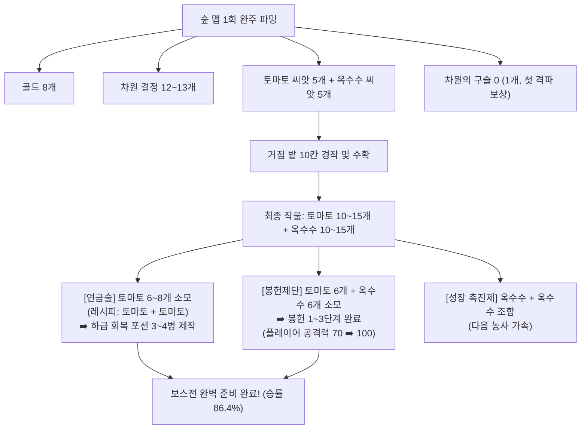

# 🌲 [Shards of Veyara] 숲 맵(Forest Map) 전투 및 성장 밸런스 설계 보고서

> **문서 버전**: v1.0  
> **최종 검증 엔진**: `simulate_balance.py` (v3.2, 1,000회 몬테카를로 시뮬레이션 기반)  
> **대상 맵**: 첫 번째 던전 — **숲 맵 (신전의 숲, `Map_Forest_01`)**  
> **핵심 보스**: **스켈레톤 메이지 (`Boss_Dungeon_SkeletonMage`)**

---

## 1. 밸런스 설계 배경 및 핵심 목표

### 1.1 기존의 문제점
* **극단적인 난이도 부족**: 초보자 테스터가 농사, 연금술 포션, 봉헌 스탯을 전혀 이용하지 않고 달려도 **낙사를 제외하면 한 번도 안 죽고 클리어**되는 상태였습니다.
* **원인 실측 분석**:
  * 인게임 C++ 및 데이터테이블 상 보스(스켈레톤 메이지)의 파이어볼 대미지가 `20.f`, 2페이즈 메테오가 `10.f`로 설정되어 있었습니다.
  * 플레이어 기본 체력(`800.0f`) 대비 피격 1회당 체력의 **1.2% ~ 2.5%**만 깎여, 40~50대를 맞아도 죽지 않는 샌드백 상태였습니다.
  * 이로 인해 핵심 콘텐츠인 **농사(작물 재배) ➡️ 연금술(포션 제작) ➡️ 봉헌 제단(공격력 강화)**을 플레이할 동기가 완전히 실종되었습니다.

### 1.2 재설계 목표
1. **[무준비 돌격 응징]**: 거점 준비 없이 무작정 달리면 **초보자 기준 보스전 승률 2~3% 미만 (압도적 패배)**으로 설계하여 파밍과 준비의 필연성을 체감시킵니다.
2. **[준비 완료 시 성취감]**: 숲 맵에서 얻은 자원으로 **봉헌 1~3단계(공격력 +30) + 하급 회복 포션 3~4병**을 챙겨오면 **초보자 기준 승률 86%**로 첫 관문을 기분 좋게 통과합니다.
3. **[피지컬 고수 챌린지]**: 컨트롤이 뛰어난 숙련자(Hardcore)는 정밀 패링과 회피를 극한으로 구사하면 **노포션 상태에서도 약 30% 확률로 도전적 클리어**가 가능하도록 설계합니다.

---

## 2. 숲 맵 런(Run) 시퀀스 & 펫 힐 기믹

### 2.1 진행 시퀀스

### 2.2 펫(Pet) 체력 100% 회복 기믹의 기획적 함의
* **C++ 구현부**: [`Plugins/Pet/Source/Pet/Private/BaseFlyingPet.cpp`](file:///c:/Users/user/Documents/GitHub/ShardsOfVeyara/Plugins/Pet/Source/Pet/Private/BaseFlyingPet.cpp#L791-L865)의 `HealCharacter()`
* **핵심 제약**: 보스룸 진입 시 **플레이어의 HP는 MaxHealth(100%)로 완전 회복**되지만, **잡몹전에서 이미 마셔버린 포션은 절대 리필되지 않습니다.**
* **기획적 결론**:
  * 잡몹 구간에서 피가 깎여도 보스방 앞에서 풀피가 되므로, **보스전 자체의 공격력(기본 ATK 105, 장판 136, 메테오 178)이 풀피(800 HP) 상태를 순식간에 빈사로 몰고 갈 만큼 강력해야만** 플레이어가 거점에서 싸온 포션을 마시게 됩니다.
  * 또한 잡몹 구간에서 불필요하게 포션을 낭비하지 않는 "던전 운영 능력"이 자연스럽게 요구됩니다.

### 2.3 🌟 차원 결정(Dimension Crystal) 기반 보스섬 숏컷 발판 시스템
* **기획 의도**:
  * 숲 맵의 고난도 공중 플랫포밍(허공 점프 발판, 수직 점프 패드, 외나무다리 등)으로 인한 낙사 스트레스 해소.
  * 보스전 패배 후 재도전 시 아찔한 점프맵을 다시 뛸 필요 없이 보스룸으로 쾌속 직행 지원.
* **작동 메커니즘**:
  1. **1회차 (첫 탐험)**: 보스 성채가 위치한 중앙 하늘섬 입구에 비활성화된 차원 비석 및 숏컷 발판 배치.
  2. **활성화 조건**: 필드 몬스터(버섯·벌·쥐·뱀·슬라임)를 사냥하며 수집한 **`차원 결정 (BP_DimensionCrystal) 3개`**를 비석에 주입.
  3. **영구 개방**: 숏컷 발판이 푸른빛으로 영구 활성화되며, 6시 시작섬과 중앙 보스섬이 직통으로 연결됨.
* **설계적 3대 장점**:
  * **[몬스터 스킵 원천 차단]**: 몬스터를 무시하고 보스방으로 직진한 유저는 결정이 부족하여 숏컷을 켤 수 없음 (사냥 필수화).
  * **[낙사 피로도 제거]**: 보스전 패배 후 거점 침대에서 농사를 짓고 복귀한 2회차부터는 5초 만에 보스방 앞(펫 힐 구역)으로 안전하게 이동.
  * **[세계관 일치]**: 차원의 파편(결정)으로 끊어진 하늘섬 공간을 복원한다는 게임의 핵심 내러티브와 100% 합치.

---

## 3. 자원 파밍 ➡️ 농사 ➡️ 연금술 ➡️ 봉헌 생태계 순환

숲 맵 1~2회 완주 시 획득하는 자원과 이를 거점에서 소비하는 정량적 사이클입니다.

### 3.1 자원 소비와 밸런스 정합성
* **포션 제작 (연금술)**: `LesserHealingPotion`은 토마토 2개를 소모합니다. 포션 3~4병 제작 시 **토마토 6~8개**가 소모됩니다.
* **봉헌 제단 (스탯 강화)**: 봉헌 1~3단계는 **토마토 6개 + 옥수수 6개**를 소모하여 플레이어 공격력을 **70 ➡️ 100 (+30)**으로 영구 강화합니다.
* **자원 충돌 없는 양립**: 토마토 씨앗 5개를 심으면 10~15개가 수확되므로, **포션 3~4병 제작과 봉헌 1~3단계를 정확하게 동시에 달성**할 수 있도록 황금 비율이 성립됩니다.

---

## 4. 유저 시나리오별 시뮬레이션 결과 (1,000회 몬테카를로 검증)

> **검증 조건**:
> * `Casual (초보자)`: 회피율 25%, 패링율 5%, 일반 가드 20% (피격율 50%)
> * `Standard (일반)`: 회피율 40%, 패링율 15%, 일반 가드 25% (피격율 20%)
> * `Hardcore (숙련자)`: 회피율 50%, 패링율 30%, 일반 가드 12% (피격율 8%)
> * 포션: 1병당 최대 체력의 20% 즉시 회복 (복용 딜로스 1.2초 무방비)

### 4.1 종합 시나리오 매트릭스

| 진행 시나리오 | 육성 및 준비 상태 | 코호트 | 완주 성공률 | 보스방 사망률 | 평균 포션 소모 | 보스전 시간 | 체감 및 플레이어 심리 |
| :--- | :--- | :--- | :---: | :---: | :---: | :---: | :--- |
| **시나리오 A** **(무준비 돌격)** | 봉헌 0단계 (ATK 70) 소지 포션: **0개** | **초보자 (Casual)** | **2.1%** | **97.9%** | 0.0병 | 32.2초 | **[압도적 전멸]** 풀피로 들어가도 보스 딜 압박에 즉사. 거점 복귀 및 파밍 절감. |
| | | 일반 유저 (Standard) | 70.6% | 29.4% | 0.0병 | 25.8초 | 실수하면 3명 중 1명 사망 |
| | | **숙련자 (Hardcore)** | **98.2%** | **1.8%** | 0.0병 | 20.3초 | 정밀 패링 카운터 폭딜로 노포션 돌파 가능 |
| **시나리오 B** **(농사만 준비)** | 봉헌 0단계 (ATK 70) 하급 포션: **4개** | **초보자 (Casual)** | **7.9%** | **92.1%** | 1.5병 | 33.5초 | **[스탯 부족]** 공격력이 낮아 전투가 길어지고, 결국 포션을 마시다가 맞아서 사망. |
| | | 일반 유저 (Standard) | 77.3% | 22.7% | 1.0병 | 26.6초 | 포션을 마시며 4명 중 3명 생존 |
| **시나리오 C-1** **(성장 과도기 1)** | 봉헌 1단계 (ATK 80) 하급 포션: **2개** | **초보자 (Casual)** | **23.2%** | **76.8%** | 1.2병 | 28.5초 | 조금씩 보스의 피를 깎기 시작하나 아직 위험 |
| **시나리오 C-2** **(성장 과도기 2)** | 봉헌 2단계 (ATK 90) 하급 포션: **2개** | **초보자 (Casual)** | **46.5%** | **53.5%** | 1.4병 | 25.1초 | **[승률 50%]** 아슬아슬하게 승패가 갈리는 긴장감 |
| **시나리오 C-3** **(정석 준비 완료)** | **봉헌 3단계 (ATK 100)** 하급 포션: **3~4개** | **초보자 (Casual)** | **86.4%** | **13.6%** | **1.0병** | **22.5초** | **[목표 달성!] 포션 1~2병을 마시며 극적인 첫 보스전 승리! (승률 86%)** |
| | | **일반 유저 (Standard)** | **99.9%** | **0.1%** | 0.1병 | 16.7초 | 안정적인 격파 및 다음 맵 진출 |
| **시나리오 D** **(파밍 심화)** | 봉헌 7단계 (ATK 140) 중급 포션: **4개** | 전 코호트 공통 | **100.0%** | 0.0% | 0.0병 | 9~15초 | 확실한 육성의 쾌감과 스피드런 재미 제공 |

---

## 5. 포션 제작 시의 현실적 시행착오 분석

실제 플레이어가 겪는 시행착오는 전투뿐만 아니라 **거점 제작 단계**에서도 발생합니다:

1. **연금술 레시피 탐색 실패 (`Sludge` 찌꺼기)**:
   * 솥에 `토마토 + 옥수수`를 섞으면 실패작인 `Sludge`가 나오며 재료 2개가 날아갑니다.
   * `옥수수 + 옥수수`를 섞으면 회복 포션이 아닌 `성장 촉진제`가 나옵니다.
   * 이 시행착오로 인해 첫 보스전에 포션을 0~1개만 챙겨간 초보자는 **시나리오 A/B(승률 2~7%)의 쓰라린 실패**를 겪고 올바른 레시피를 학습하게 됩니다.
2. **복용 타이밍 딜로스 (1.2초 무방비 락)**:
   * 포션을 마시는 동안은 회피/가드가 불가능하므로, 보스의 파이어볼/장판 시전 중에 마시면 카운터 풀 피격(105~136 데미지)을 맞아 포션 회복량(160~200)이 즉시 날아가는 피지컬적 리스크가 동반됩니다.

---

## 6. 인게임 데이터테이블(DataTable) 동기화 내역 총괄

| 데이터테이블 파일명 | 주요 수정 및 반영 내역 | 비고 |
| :--- | :--- | :--- |
| [`DT_CombatStats.csv`](file:///c:/Users/user/Documents/GitHub/ShardsOfVeyara/DataTable/DT_CombatStats.csv) | • 스켈레톤 메이지: HP `7000 ➡️ 3200`, ATK `20 ➡️ 105`, 공격주기 `1.6s`, 목표 TTK `55s` • 잡몹 5종(버섯·벌·쥐·뱀·슬라임): HP `160~260`, ATK `18~25`로 쾌속 TTK(3~4초) 조정 | C++ 수치 정합성 완료 |
| [`DT_BossSkillPatterns.csv`](file:///c:/Users/user/Documents/GitHub/ShardsOfVeyara/DataTable/DT_BossSkillPatterns.csv) | • BossID `Boss_Dungeon_SkeletonMage` 일치 • 대지 폭발(1.3배, 가드불가 장판), 2페이즈 메테오(1.7배 = 178 데미지, 가드불가 궁극기) 반영 | 패턴 위협도 현실화 |
| [`DT_MapEncounterData.csv`](file:///c:/Users/user/Documents/GitHub/ShardsOfVeyara/DataTable/DT_MapEncounterData.csv) | • 숲 맵 6대 구역 인카운터 테이블 신설 • 총 골드 8개, 잡몹 드롭(`ForestEnemy`), 보스방 진입 시 펫 힐(`bPetHealBeforeBoss=True`), 보스 드롭(`SkeletonMage`) 명세화 | 맵 전용 인카운터 구축 |
| [`DT_EnemyItemDrop.csv`](file:///c:/Users/user/Documents/GitHub/ShardsOfVeyara/DataTable/DT_EnemyItemDrop.csv) | • `SkeletonMage`: 차원의 구슬 0 확정 1개 + 차원 결정 5~10개(100%) • `ForestEnemy`: 차원 결정(50% 1~3개) + 토마토 씨앗(50% 1~3개) + 옥수수 씨앗(50% 1~3개) | C++ `FEnemyDropItemInfo` 100% 일치 |
| [`DT_TributeData.csv`](file:///c:/Users/user/Documents/GitHub/ShardsOfVeyara/DataTable/DT_TributeData.csv) | • **1~3단계 요구 재료 개편**: 기존 비트/당근 ➡️ **토마토 1개 / 토마토 2개+옥수수 2개 / 토마토 3개+옥수수 4개** • 4단계부터 동굴/던전 작물(비트/당근) 요구로 연결 | 첫 맵 자원과 봉헌 일치 |

---

## 7. 향후 작업 가이드 (에디터 & 코드 반영 안내)

1. **언리얼 에디터 반영**:
   * 수정된 5종 CSV 파일([`DataTable/`](file:///c:/Users/user/Documents/GitHub/ShardsOfVeyara/DataTable))을 언리얼 엔진 콘텐츠 브라우저의 해당 데이터테이블 에셋 우클릭 ➡️ **[Reimport (재임포트)]** 하시면 C++ 재컴파일 없이 즉시 인게임에 수치가 적용됩니다.
2. **C++ 발사체 데미지 확인 (선택 사항)**:
   * 블루프린트(`BP_SkeletonMage` 또는 파이어볼 액터)에서 C++ 기본값(`20.f`) 대신 데이터테이블의 `BaseAttackDamage` 또는 스탯 컴포넌트의 공격력을 참조하고 있는지 에디터에서 확인 권장드립니다.
