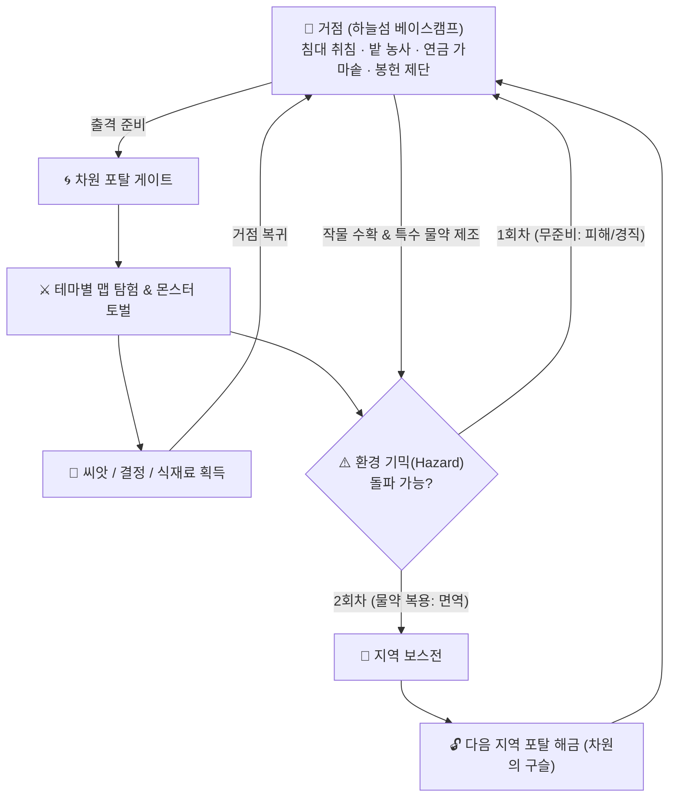

# 🗺️ Shards of Veyara - 전체 게임 진행 흐름도 (Game Progression Master Flow)

---

## 1. 게임의 핵심 루프 (The Core Gameplay Loop)

샤즈 오브 베이야라는 **[탐험 및 전투 ➡️ 자원/씨앗 획득 ➡️ 거점 귀환 (침대 취침/농사/연금술/봉헌) ➡️ 상위 단계 돌파]**의 유기적 선순환 구조를 가집니다.  
단순한 컨트롤 스피드런을 지양하며, **거점의 생활(농경·연금·봉헌)**이 전투 승패를 가르는 핵심 열쇠가 됩니다.

---

## 2. 거점(하늘섬)의 4대 핵심 시스템과 규칙

1. **낮과 밤(Day & Night) 사이클 및 침대(Bed) 상호작용**:
   * 필드와 거점은 실시간으로 낮과 밤이 흐릅니다.
   * 밤이 되거나 필드에서 귀환한 뒤 **침대에서 상호작용(취침)**하면:
     * 즉시 다음 날 아침으로 시간 스킵 (`NextDay`).
     * 플레이어 체력 100% 완전 회복.
     * 거점 밭에 심어진 작물이 **1일치 성장 완료 (수확 가능)**.
2. **사망 및 리스폰 규칙**:
   * **하늘섬 낙사**: 해당 맵의 직전 체크포인트에서 체력 유지 상태로 즉시 부활.
   * **체력 0 사망**: 당일 탐험 실패로 간주, **거점의 침대로 강제 사출** (소지품 보존, 하루 마감).
3. **봉헌 제단 (Tribute Altar)**:
   * 수확한 작물과 결정을 제단에 바쳐 플레이어의 공격력을 영구 강화 (`Damage +10`씩 누적).
4. **연금술 가마솥 (Alchemy Pot)**:
   * 작물 2종을 조합하여 일반 회복 포션 및 **맵 전용 환경 저항 비약** 조제.

---

## 3. 전체 맵 단계별 진행 시나리오 (Stage 1 ~ Stage 4)

---

### 🌲 1단계: 숲 (Forest Map) - 【튜토리얼 & 기초 전투 및 봉헌】

* **테마**: 평화로워 보이지만 타락한 고대 하늘 숲.
* **해금 상태**: 게임 시작 시 기본 개방.
* **등장 몬스터**: 잡몹 5종 (버섯 Mushroom, 벌 Bee, 쥐 Rat, 뱀 Snake, 슬라임 Slime).
* **획득 자원**:
  * 골드 8개.
  * 몬스터 처치 시: **토마토 씨앗/열매(`tomato`)**, **옥수수 씨앗/열매(`corn`)**, 차원 결정.
* **진행 흐름**:
  1. **필드 탐색**: 6시 방향에서 반시계 방향으로 돌며 잡몹 5종을 사냥하고 자원 수집.
  2. **보스방 직전 펫 힐 기믹**: 비행 펫이 보스방 입장 직전 플레이어의 체력을 100% 회복시켜 줌.
  3. **첫 보스 도전의 벽**:
     * 무준비(봉헌 0단계, 공격력 70, 포션 없음)로 진입 시 **스켈레톤 메이지**의 높은 체력(3,200)과 메테오/장판 패턴에 밀려 패배(승률 2.1%).
  4. **거점 농사 & 봉헌**:
     * 수집한 토마토와 옥수수를 재배 ➡️ 제단에 바쳐 **봉헌 1~3단계** 달성 (공격력 70 ➡️ 100).
     * 여분의 토마토로 회복 포션 제조.
  5. **보스 격파**: 공격력 100 + 포션 4개를 지참하고 재도전하여 스켈레톤 메이지 토벌 (승률 86.4%).
* **클리어 보상**: **차원의 구슬 0 (Dimension Orb 0)** 획득 ➡️ 거점에서 던전 포탈 개방.

---

### 🏰 2단계: 던전 (Dungeon Map) - 【패링·가드 정예 전투 & 연금술 심화】

* **테마**: 버려진 고딕 지하 성채.
* **해금 조건**: 숲 보스(스켈레톤 메이지) 토벌 및 차원의 구슬 0 활성화.
* **등장 몬스터**: 중장갑 해골 기사, 마도 골렘, 원거리 강령술사 등 정예형 몬스터.
* **획득 자원**:
  * 몬스터 처치 시: **당근(`carrot`)**, **비트(`beet`)**, 상위 차원 결정.
* **진행 흐름**:
  1. **정예 전투 학습**: 공격을 무지성으로 난타하면 막히거나 반격당함. 방패 가드와 패링 타이밍 숙달 필요.
  2. **농사 & 연금술 심화**:
     * 당근과 비트를 수확하여 상위 체력 회복 포션 및 스태미나 활력 포션 제작.
     * 봉헌 4~6단계 달성으로 기본 공격력 추가 증강 (ATK 100 ➡️ 130).
  3. **보스전**: **블랙 나이트 (Black Knight)**.
     * 강력한 방패 가드 및 연속 베기, 대지 강타 시전.
     * 패링으로 그로기를 유도하고 강화된 공격력으로 격파.
* **클리어 보상**: **차원의 구슬 1** 획득 ➡️ 거점에서 동굴 포탈 개방.

---

### 🌋 3단계: 동굴 (Cave Map) - 【환경 장벽: 극열 용암 & 밀(Wheat) 방염 루프】

* **테마**: 부글거리는 용암과 화산 암반 지대.
* **해금 조건**: 던전 보스(블랙 나이트) 토벌 및 차원의 구슬 1 활성화.
* **환경 기믹 (Hazard)**: **【극열 화염 지속 피해 (Extreme Heat)】**
  * 효과: 초당 최대 체력의 **3.0% 지속 피해** + 이동속도 **20% 감소**.
  * 무준비 진입 시: 진입 후 30~40초 만에 체력이 고갈되어 심층 보스방 도달 전 사망 사출.
* **진행 흐름 (2단계 공략)**:
  1. **1회차 (입구 정찰 & 씨앗 파밍)**:
     * 극열 피해를 버티며 동굴 입구 구역(Zone 1~2)의 몬스터를 신속히 처치.
     * 몬스터로부터 **밀 씨앗(`BP_Seed_Wheat`)** 획득 ➡️ 체력이 다 떨어지기 전 귀환 (혹은 사망 귀환).
  2. **거점 농사 & 연금술**:
     * 밀을 심고 취침하여 **밀(Wheat)** 수확.
     * 던전에서 파밍해둔 **당근(Carrot)**과 가마솥에서 조합:  
       👉 **`밀 x 2 + 당근 x 2` ➡️ [내화 비약 (Fire Resistance Potion)]** 완성!
  3. **2회차 (심층 돌파 및 보스전)**:
     * 내화 비약 복용 (**4분간 화염 지속 피해 100% 면역** 및 정상 이속 확보).
     * 펄펄 끓는 심층 용암 지대를 여유롭게 돌파하여 보스룸 도달.
     * 보스 **보스웜 / 화산 거수** 토벌.
* **클리어 보상**: **차원의 구슬 2** 획득 ➡️ 거점에서 현대 도시 포탈 개방.

---

### 🏙️ 4단계: 현대 도시 (City Map) - 【환경 장벽: 전자기장 EMP & 쌀(Rice) 절연 루프】

* **테마**: 마도공학 문명이 붕괴된 현대 디스토피아 메트로폴리스 (빌딩 숲, 아스팔트, 끊어진 고압선).
* **해금 조건**: 동굴 보스 토벌 및 차원의 구슬 2 활성화.
* **환경 기믹 (Hazard)**: **【글로벌 전자기 펄스 방전 (Global EMP)】**
  * 효과: 도시 맵 전체에 **5초 주기**로 전자기 충격파가 울려 플레이어에게 **0.8초 강제 경직(스턴/Flinch)** 발생.
  * 무준비 진입 시: 적과의 교전 도중 계속해서 캐릭터가 굳어버려 공격 캔슬 및 피격 누적으로 통과 불가능.
* **진행 흐름 (2단계 공략)**:
  1. **1회차 (외곽 정찰 & 씨앗 파밍)**:
     * 주기적 경직을 조심스럽게 버티며 도시 외곽의 적을 사냥.
     * 적으로부터 **쌀 씨앗(`BP_Seed_Rice`)** 획득 ➡️ 거점 복귀.
  2. **거점 농사 & 연금술**:
     * 쌀을 심고 취침하여 **쌀(Rice)** 수확.
     * 던전에서 파밍해둔 **비트(Beet)**와 가마솥에서 조합:  
       👉 **`쌀 x 2 + 비트 x 2` ➡️ [전자기 절연수 (Shock Resistance Potion)]** 완성!
  3. **2회차 (도심 심장부 돌파 및 최종 결전)**:
     * 전자기 절연수 복용 (**4분간 EMP 주기적 경직 100% 면역** + 방어력 버프).
     * 전자기 펄스를 무시하고 고속 질주 및 매끄러운 콤보 액션 구사.
     * 마천루 최상층에서 최종 보스 **마법검사 (Magic Swordsman)**와 진검승부 후 격파.
* **클리어 보상**: **최종 차원의 핵** 회수 ➡️ 차원의 균열 봉인 및 엔딩 크레딧.

---

## 4. 전체 진행 요약 매트릭스

| 스테이지 | 환경 기믹 (Hazard) | 파밍 핵심 작물 | 연금술 핵심 포션 | 제작 조합식 | 지역 보스 | 해금 보상 |
| :--- | :--- | :--- | :--- | :--- | :--- | :--- |
| **1. 숲** | 없음 (기초 전투) | **토마토**, **옥수수** | 기본 체력 포션 | 토마토 기반 | 스켈레톤 메이지 | 차원의 구슬 0 (던전 개방) |
| **2. 던전** | 없음 (패링/가드 강요) | **당근**, **비트** | 고급 활력/회복 포션 | 당근 + 비트 | 블랙 나이트 | 차원의 구슬 1 (동굴 개방) |
| **3. 동굴** | **극열 화염 DoT** (초당 3% HP, 이속 -20%) | **밀 (Wheat)** | **내화 비약** (4분간 화염 면역) | `밀 x 2` + `당근 x 2` | 보스웜 | 차원의 구슬 2 (도시 개방) |
| **4. 도시** | **글로벌 전자기장 EMP** (5초마다 0.8초 경직) | **쌀 (Rice)** | **전자기 절연수** (4분간 경직 면역) | `쌀 x 2` + `비트 x 2` | 마법검사 | 최종 차원의 핵 (엔딩) |
