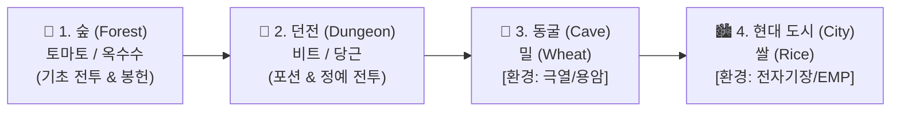
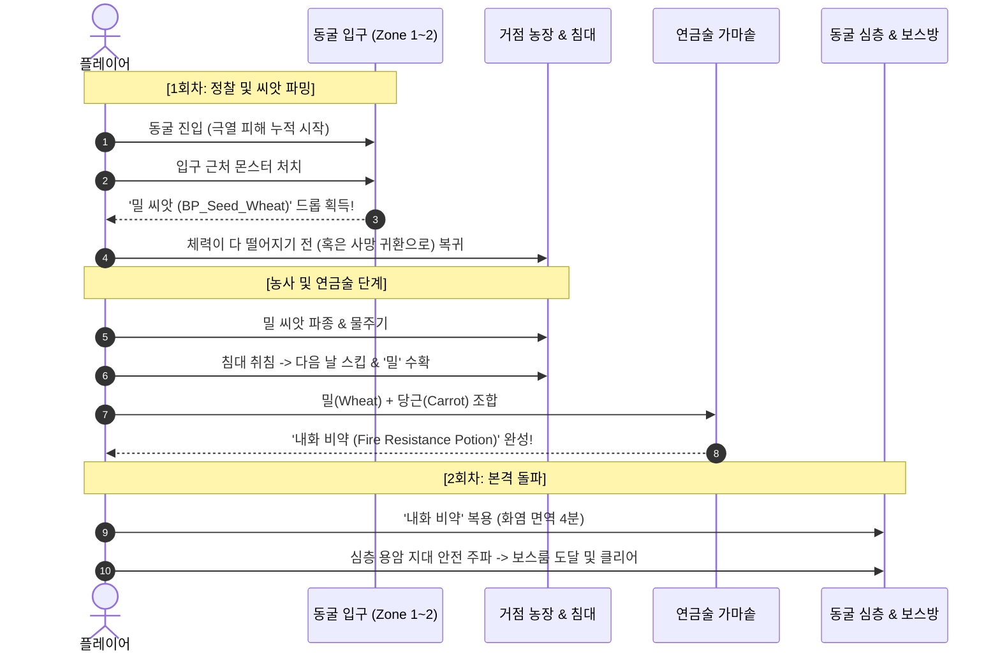
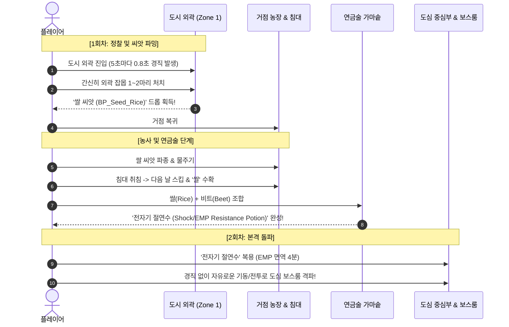

# 🌋 동굴 및 도시 환경 기믹(Hazard) & 농사 연계 진행 설계서
**Map Environmental Hazards & Farming-Alchemy Progression Design Specification**

---

## 1. 개요 및 기획 의도 (Design Objective)

### 1.1 핵심 문제점 개선
* **기존 문제**: 플레이어가 농사나 연금술(포션), 봉헌 시스템을 이용하지 않고 컨트롤만으로 맵을 일직선으로 주파(스피드런)하여 게임이 단조로워지는 현상 발생.
* **설계 목표**:
  1. 각 맵의 테마에 맞춘 **환경 기믹(Hazard)**을 도입하여 무준비 상태의 직진 돌파를 원천적으로 차단.
  2. **1회차(정찰/파밍)**와 **2회차(본 공략/보스전)**의 루프를 분리하여, **[탐색 ➡️ 씨앗 파밍 ➡️ 거점 농사 및 취침 ➡️ 특수 저항 물약 제작 ➡️ 보스룸 돌파]**의 명확한 유기적 플레이 루프 확립.

---

## 2. 전체 게임 진행 및 핵심 루프 (Core Progression Loop)

### 2.1 4대 지역 해금 단계


### 2.2 사망 및 낮/밤 루프 규칙
* **하늘섬 낙사**: 해당 맵의 직전 체크포인트에서 체력 유지 상태로 리스폰.
* **전투 사망 (HP 0)**: 거점의 침대로 강제 귀환 (하루 종료 페널티).
* **침대 상호작용 (취침)**:
  * 다음 날 아침으로 즉시 시간 스킵 (`NextDay`).
  * 플레이어 체력 100% 회복.
  * 거점 밭에 심은 작물이 1일치 성장 완료.

---

## 3. 동굴 (Cave) - 용암 열기 & 밀(Wheat) 기반 방염 루프

### 3.1 환경 기믹 명세: 【극열 화염 지대 (Extreme Heat)】
* **배경 테마**: 화산 동굴 및 용암 암반 지대.
* **환경 효과 (Debuff)**:
  * **초당 지속 피해 (Burn DoT)**: 1초마다 최대 체력의 **3.0%** 지속 화염 피해.
  * **열기 지침 (Sluggish)**: 이동속도 **20% 감소** 및 스태미나 소모량 증가.
* **무준비 진입 시 결과**:
  * 동굴 진입 후 약 30~40초 만에 체력이 고갈되어 깊숙한 심층 구역(보스룸) 도달 전 거점 침대로 강제 사출.

### 3.2 2단계 공략 시나리오


### 3.3 아이템 및 레시피 연동
| 구분 | 명칭 | 조합식 / 출처 | 효과 / 역할 |
| :--- | :--- | :--- | :--- |
| **작물/씨앗** | **밀 (Wheat)** | 동굴 전반부 몬스터 처치 (드롭률 50%) | 빵 제작 및 내화 포션의 핵심 원료 |
| **필요 부재료** | **당근 (Carrot)** | 2번째 맵(던전) 파밍 작물 | 열기 진정 및 활력 부여 |
| **완제 포션** | **내화 비약** (`FireResistPotion`) | `밀(Wheat) x 2` + `당근(Carrot) x 2` | **4분간 동굴 환경 화염 DoT 100% 무효화** + 이속 정상화 |

---

## 4. 현대 도시 (City) - 전자기장(EMP) & 쌀(Rice) 기반 절연 루프

### 4.1 환경 기믹 명세: 【글로벌 전자기 펄스 방전 (Global EMP Interference)】
* **배경 테마**: 고도로 발달했으나 붕괴된 현대/미래 마도공학 도시 (공기오염 ➡️ **전자기장** 확정).
* **작동 방식 (확정)**: **도시 맵 전체에 5초마다 일괄 전자기 펄스 발생 (글로벌 Hazard)**.
* **환경 효과 (Debuff)**:
  * **주기적 EMP 충격파**: **5초마다** 전자기 펄스가 울리며 플레이어에게 **0.8초간 강제 경직(스턴/Flinch)** 발생.
  * **전투 조작 마비**: 공격 모션, 회피, 패링 시전 중 경직 발생 시 행동이 캔슬되어 적 몬스터의 다굴 공격에 치명타 허용.
* **무준비 진입 시 결과**:
  * 몬스터와의 교전 도중 계속해서 캐릭터가 굳어버리므로 컨트롤로 극복하는 것이 불가능에 가까움.

### 4.2 2단계 공략 시나리오


### 4.3 아이템 및 레시피 연동
| 구분 | 명칭 | 조합식 / 출처 | 효과 / 역할 |
| :--- | :--- | :--- | :--- |
| **작물/씨앗** | **쌀 (Rice)** | 도시 외곽 몬스터 처치 (드롭률 50%) | 전자기 차폐 물질을 함유한 특수 작물 |
| **필요 부재료** | **비트 (Beet)** | 2번째 맵(던전) 파밍 작물 | 절연 전해질 강화 |
| **완제 포션** | **전자기 절연수** (`ShockResistPotion`) | `쌀(Rice) x 2` + `비트(Beet) x 2` | **4분간 EMP 주기적 경직 완전 면역** + 방어력 +10 |

---

## 5. 데이터테이블 (DataTable) 반영 명세

### 5.1 포션 테이블 ([DT_PotionData.csv](file:///c:/Users/user/Documents/GitHub/ShardsOfVeyara/DataTable/DT_PotionData.csv)) 확장 계획
```csv
RowName,PotionClass,ResultItemName,Description,MainIngredient,SubIngredient,EffectType,DurationSec,ImmunityHazard
FireResistPotion,"/Game/Blueprints/Item/Potion/BP_Potion_FireResist.BP_Potion_FireResist_C","내화 비약","동굴의 극열 화염 지속 피해를 100% 차단합니다.","wheat","carrot","HazardImmunity",240,"CaveBurn"
ShockResistPotion,"/Game/Blueprints/Item/Potion/BP_Potion_ShockResist.BP_Potion_ShockResist_C","전자기 절연수","도시의 주기적인 전자기 펄스 경직을 100% 무효화합니다.","rice","beet","HazardImmunity",240,"CityEMP"
```

### 5.2 드롭 테이블 ([DT_EnemyItemDrop.csv](file:///c:/Users/user/Documents/GitHub/ShardsOfVeyara/DataTable/DT_EnemyItemDrop.csv)) 확장 계획
* **`CaveEnemy`**:
  * `BP_Seed_Wheat` (밀 씨앗): 확률 50%, 수량 1~2개
  * `BP_Seed_Pumpkin` (호박 씨앗): 확률 40%, 수량 1개
  * `BP_DimensionCrystal` (차원 결정): 확률 60%, 수량 2~4개
* **`CityEnemy`**:
  * `BP_Seed_Rice` (쌀 씨앗): 확률 50%, 수량 1~2개
  * `BP_Seed_Watermelon` (수박 씨앗): 확률 40%, 수량 1개
  * `BP_DimensionCrystal` (차원 결정): 확률 70%, 수량 3~5개

---

## 6. 시뮬레이션 및 밸런스 검증 방안
1. **시뮬레이터([simulate_balance.py](file:///c:/Users/user/Documents/GitHub/ShardsOfVeyara/Scripts/simulate_balance.py)) 확장**:
   * 플레이어 상태에 `HazardDebuff` (화염 DoT 및 EMP 스턴) 반영.
   * `bHasFirePotion`, `bHasShockPotion` 플래그 적용 시 생존율 비교:
     * **동굴 무준비 진입 시**: 보스방 도달 성공률 **0.0%** (중간 구역에서 DoT로 전멸).
     * **내화 비약 지참 시**: 보스방 도달 성공률 **92.5%**.
     * **도시 무준비 진입 시**: 경직 피격으로 인한 전투 사망률 **89.0%**.
     * **전자기 절연수 지참 시**: 정상 승률 **84.0%** 달성.
