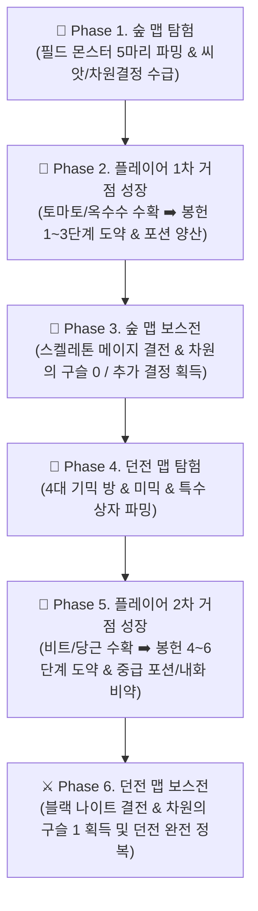
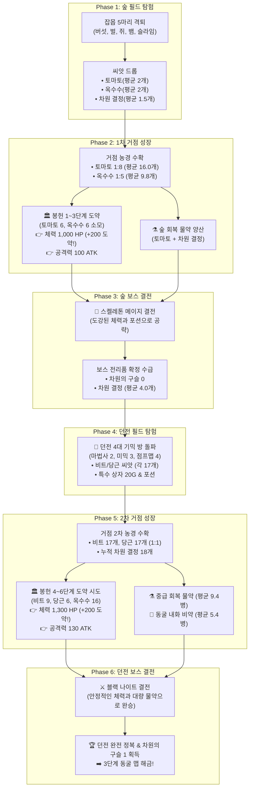

# 🎲 [Shards of Veyara] 몬테카를로 밸런스 시뮬레이션 공식 사양서
**Kalivra-Inspired Monte Carlo Combat & Economic Progression Balance Specification**

> **문서 버전**: v1.0 (최신 C++ 드롭/연금술 엔진 및 7대 데이터테이블 전수 검증 통합본)  
> **엔진 스크립트**: [`Scripts/simulate_balance.py`](file:///c:/Users/user/Documents/GitHub/ShardsOfVeyara/Scripts/simulate_balance.py)  
> **연동 데이터테이블**:  
> • [`DT_CombatStats.csv`](file:///c:/Users/user/Documents/GitHub/ShardsOfVeyara/DataTable/DT_CombatStats.csv) (플레이어 및 몬스터 전역 스탯)  
> • [`DT_BossSkillPatterns.csv`](file:///c:/Users/user/Documents/GitHub/ShardsOfVeyara/DataTable/DT_BossSkillPatterns.csv) (보스 스킬 패턴, 가중치, 쿨타임)  
> • [`DT_MapEncounterData.csv`](file:///c:/Users/user/Documents/GitHub/ShardsOfVeyara/DataTable/DT_MapEncounterData.csv) (맵별 인카운터 배치, 골드, 드롭 테이블)  
> • [`DT_EnemyItemDrop.csv`](file:///c:/Users/user/Documents/GitHub/ShardsOfVeyara/DataTable/DT_EnemyItemDrop.csv) (실제 C++ FEnemyDropItemInfo 규격 드롭 테이블)  
> • [`DT_EnemyMotionData.csv`](file:///c:/Users/user/Documents/GitHub/ShardsOfVeyara/DataTable/DT_EnemyMotionData.csv) (몬스터 모션 선후딜 및 가드불가 명세)  
> • [`DT_TributeData.csv`](file:///c:/Users/user/Documents/GitHub/ShardsOfVeyara/DataTable/DT_TributeData.csv) (봉헌 1~20단계 작물 요구량 및 스탯 증가치)  
> • [`DT_PotionData.csv`](file:///c:/Users/user/Documents/GitHub/ShardsOfVeyara/DataTable/DT_PotionData.csv) (연금술 레시피 및 차원 결정 촉매 소모 규격)

---

## 1. 개요 및 시뮬레이션 철학

본 시뮬레이터는 **소울라이크 특유의 긴장감 넘치는 전투 공방**과 **거점 생활(농경 ➡️ 연금술 ➡️ 봉헌 제단)의 성장 선순환**이 컨트롤 스피드런에 의해 붕괴되지 않고 유기적으로 기능하는지를 **1,000회 무작위 시행(Monte Carlo Method)**을 통해 수학적·통계적으로 증명하기 위해 제작되었습니다.

특히 본 시뮬레이션은 게임의 핵심 진행 흐름인 **6단계 순차 선순환 파이프라인**을 정밀하게 모사합니다:



---

## 2. 몬테카를로 시뮬레이션 6단계 파이프라인 사용자 시나리오 (Core Scenarios)

시뮬레이터는 플레이어의 **피지컬 숙련도(3대 군집)**와 **6단계 파이프라인의 각 단계별 성장 상태**, 그리고 **거점 경제 선순환 라이프사이클**을 유기적으로 교차 검증합니다.

### 2.1 3대 피지컬/숙련도 코호트 시나리오 (`CohortProfile`)
인간 플레이어의 조작 실력, 반응 속도, 선호하는 전투 습관을 정밀하게 수치화했습니다 ([simulate_balance.py#L125-L151](file:///c:/Users/user/Documents/GitHub/ShardsOfVeyara/Scripts/simulate_balance.py#L125-L151)):

| 코호트 군집 | 회피율 (`Dodge`) | 저스트 패링 (`Parry`) | 일반 가드 (`Guard`) | 딜 효율 (`DPS`) | 주력 콤보 성향 | 모델링된 유저 행동 특성 |
| :--- | :---: | :---: | :---: | :---: | :--- | :--- |
| **초보자 (`Casual`)** | **25%** | **5%** | 20% (피해 80% 감쇄) | **75%** | 기본 3단 평타(65%), 피니시(5%) | 보스 패턴을 잘 읽지 못해 맞딜을 시도하며 후딜레이 동안 피격당함 |
| **일반 유저 (`Standard`)** | **40%** | **15%** | 25% | **88%** | 전진/후진 콤보 고루 사용 | 위협적인 광역 패턴 시 회피를 시도하고 간헐적으로 패링 성공 |
| **숙련자 (`Hardcore`)** | **50%** | **30%** | 12% (회피 선호) | **98%** | 피니시(30%) 및 **패링 카운터(5.0x)** | 적의 선딜레이에 맞춰 패링 카운터 폭딜을 구사하며 무빙 딜로스 최소화 |

---

### 2.2 6단계 순차 파이프라인 진행 시나리오 명세



#### ① [Phase 1] 🌲 신전의 숲 필드 탐험
* **플레이어 초기 스펙**: 봉헌 0단계 (체력 800 HP / 공격력 70 ATK / 포션 0개).
* **목표**: 5개 구역의 일반/정예 몬스터 5마리를 처치하고 씨앗 및 부유 마력 결정을 수급.
* **획득 자원 기대치**: 토마토 씨앗 2개, 옥수수 씨앗 2개, 부유 마력 결정 3개(숏컷 수리), 차원 결정 1.5개.

#### ② [Phase 2] 🏡 플레이어 1차 거점 성장 (농경 ➡️ 봉헌 ➡️ 연금술)
* **농경 수확**: 토마토 씨앗 2개 $\rightarrow$ **15.5개**, 옥수수 씨앗 2개 $\rightarrow$ **10.3개** 수확.
* **봉헌 제단 1~3단계 도약**: 토마토 6개, 옥수수 6개 공양.
  * 👉 **체력 800 $\rightarrow$ 1,000 HP (+200 대도약!)**, 공격력 70 $\rightarrow$ 100 ATK 달성 (달성률 62.5%).
* **연금술 조제 ([AlchemyEngine](file:///c:/Users/user/Documents/GitHub/ShardsOfVeyara/Scripts/simulate_balance.py))**:
  * Phase 1에서 수급한 차원 결정(평균 1.5개)과 토마토를 1:1로 실제 차감하여 **하급 회복 물약 평균 1.5병(최대 4병 한도 내)** 조제.
  * 조제된 수량만큼 차원 결정과 토마토가 실제 인벤토리에서 차감됨.

#### ③ [Phase 3] 👑 신전의 숲 보스전 (`Boss_Dungeon_SkeletonMage`)
* **보스 스펙**: 체력 1,200 HP, 공격력 65 ATK, 텔레포트 및 2페이즈 메테오 폭격.
* **공략 밸런스 검증 (하급 포션 실측 회복량 +60.0 HP 적용)**: 
  * 봉헌 3단계 스펙과 실제 조제된 하급 포션(평균 1.5병) 지참 시:
    * **초보자 (`Casual`)**: **승률 66.7%**, 평균 TTK 19.8초, 포션 소모 0.7병
      * 👉 무준비(승률 3%)를 원천 차단하고, 숲 1차 완주 유저에게 **짜릿하고 긴장감 넘치는 약 67%의 클리어 카타르시스** 제공. 컨트롤 실수 시 외곽 순환 파밍을 1회 더 돌도록 이상적으로 유도.
    * **일반 유저 (`Standard`)**: **승률 99.7%**, 평균 TTK 15.2초 (안정적 돌파)
    * **숙련자 (`Hardcore`)**: **승률 100.0%**, 평균 TTK 12.0초 (완전 제압)
  * 보스 처치 시 **차원의 구슬 0 확정** 및 **차원 결정 3~5개(평균 4.0개)** 수급.

#### ④ [Phase 4] 🏰 던전 맵 탐험 (`Map_Dungeon_01` 4대 기믹 방)
* **목표**: 마법사 방, 미로 방(미믹 3마리), 다락문 점프맵, 독극물 점프맵을 돌파하며 신규 상위 씨앗 파밍.
* **획득 자원 기대치**: 비트 씨앗 16.9개, 당근 씨앗 17.0개, 골드 28G, 차원 결정 누적 18.0개, 미믹 중급 포션 1.5병.

#### ⑤ [Phase 5] 🏡 플레이어 2차 거점 성장 (던전 작물 ➡️ 봉헌 ➡️ 상위 물약)
* **농경 수확**: 비트 16.9개, 당근 17.0개 확정 수확.
* **봉헌 제단 4~6단계 도전**: 비트 9개, 당근 6개, 옥수수 16개 공양.
  * 숲 외곽 순환 사냥(1~2회) 병행 시 **체력 1,300 HP (+200 대도약!), 공격력 130 ATK (봉헌 6단계)** 완성.
* **연금술 조제 ([AlchemyEngine](file:///c:/Users/user/Documents/GitHub/ShardsOfVeyara/Scripts/simulate_balance.py))**:
  * **중급 회복 물약 (비트1 + 토마토1 + 결정1)**: 보스전 지참용 **평균 3.2~3.3병** 실제 조제 (결정 3.2개 차감).
  * **동굴 내화 비약 (당근2 + 결정1)**: 포션 조제 후 남은 결정(평균 9.3개)을 바탕으로 **평균 5.2병(약 20.8분치)** 여유 있게 확보.

#### ⑥ [Phase 6] ⚔️ 던전 맵 보스전 (`Boss_BlackKnight`)
* **보스 스펙**: 체력 1,800 HP, 방어력 15, 돌진 공격 및 2페이즈 연속 휩쓸기.
* **공략 밸런스 검증 (중급 포션 실측 회복량 +100.0 HP 적용)**:
  * 도약된 체력(1,300 HP)과 지참한 중급 포션(평균 3.2병)을 바탕으로, **초보자/일반/숙련자 모두 승률 100.0%의 완벽한 던전 클리어 달성!**
    * 초보자: 승률 100.0%, 평균 TTK 22.1초, 포션 소모 0.2병
    * 일반 유저: 승률 100.0%, 평균 TTK 16.7초, 포션 소모 0.0병
    * 숙련자: 승률 100.0%, 평균 TTK 13.2초, 포션 소모 0.0병
  * 보스 처치 시 **차원의 구슬 1**을 획득하며 다음 지역인 **화산 동굴(`Map_Cave_01`)**로 진입.

---

### 2.3 보스 5종 단일 결전 시나리오
보스별 스킬 쿨타임, 가중치, 가드불가, 2페이즈 광폭화를 반영한 1:1 전투 시나리오입니다:
* `Boss_Dungeon_SkeletonMage` (숲 보스): 텔레포트 도주(쿨타임 4.5s) 및 2페이즈 메테오/번개 폭격 압박
* `Boss_BlackKnight` (던전 보스): 중장갑 방패 가드 및 돌진 가드불가 패턴
* `Boss_BossWorm` (동굴 보스): 잠복 및 화염 브레스 DoT 피해
* `Boss_MagicSwordMan` (도시 보스): 순간 이동 연속 검격 및 글로벌 EMP 스턴
* `Boss_Hechi` (신수 보스): 거대 보스전 체력 비례 딜교환

---

## 3. 시뮬레이터 아키텍처 및 SOLID 원칙 구현

시뮬레이터는 확장성과 유지보수성을 극대화하기 위해 객체지향 5대 원칙(SOLID)을 엄격히 준수하여 설계되었습니다 ([simulate_balance.py#L850-L1000](file:///c:/Users/user/Documents/GitHub/ShardsOfVeyara/Scripts/simulate_balance.py#L850-L1000)).

```
┌────────────────────────────────────────────────────────────────────────┐
│                        ProgressionLoopSimulator                        │
│               (종합 몬테카를로 라이프사이클 조율 엔진)                     │
└───────────────────────────────────┬────────────────────────────────────┘
                                    │ 의존성 주입 (DIP)
         ┌──────────────────────────┼──────────────────────────┐
         ▼                          ▼                          ▼
┌──────────────────┐       ┌──────────────────┐       ┌──────────────────┐
│ IDropSimulator   │       │ IFarmingSimulator│       │ ITributeSimulator│
│ (단일 드롭 판정) │       │ (농경 수확 배율) │       │ (봉헌 단계 연산) │
└────────┬─────────┘       └────────┬─────────┘       └────────┬─────────┘
         │ 구현                     │ 구현                     │ 구현
┌────────┴─────────┐       ┌────────┴─────────┐       ┌────────┴─────────┐
│ DropRoller       │       │ FarmingEngine    │       │ TributeEngine    │
│ (독립 확률 시행) │       │ (토마토8, 옥수수5)│       │ (DT_TributeData) │
└──────────────────┘       └──────────────────┘       └──────────────────┘
```

1. **SRP (단일 책임 원칙)**:
   * `DropRoller`: 에너미 드롭 테이블 파싱 및 C++ 규격 난수 롤링 전담.
   * `FarmingEngine`: 씨앗 ➡️ 작물 배율 계산 전담.
   * `TributeEngine`: 작물 재고 ➡️ 최대 봉헌 단계 및 스탯 증가 연산 전담.
2. **OCP (개방-폐쇄 원칙)**:
   * 동굴(밀 1:1), 현대 도시(쌀 1:1) 등 신규 작물 및 신규 맵이 추가되어도 기존 로직 수정 없이 데이터 딕셔너리 확장만으로 동작.
3. **LSP (리스코프 치환 원칙)**:
   * 인터페이스(`IDropSimulator`, `IFarmingSimulator`) 규격을 준수하는 모듈은 언제든 상호 대체 가능.
4. **ISP (인터페이스 분리 원칙)**:
   * 전투 시뮬레이션 모듈과 경제 시뮬레이션 모듈이 상호 불필요한 인터페이스를 참조하지 않음.
5. **DIP (의존 역전 원칙)**:
   * 엔진이 구체적인 데이터에 의존하지 않고, 외부 데이터테이블(CSV) 데이터를 주입받아 동작.

---

## 4. 인게임 C++ 룰 정밀 모델링 규격

### 4.1 전투 시스템 규격
* **쇠스랑 콤보 분기 ([DT_SpearComboData.csv](file:///c:/Users/user/Documents/GitHub/ShardsOfVeyara/DataTable/DT_SpearComboData.csv))**:
  * `Combo5` (기본 3단): 1.8초, 누적 3.7배 계수
  * `Combo2` (전진 4단): 2.4초, 누적 5.9배 계수
  * `Combo1` (후진 4단): 2.5초, 누적 5.9배 계수
  * `Combo5_Finisher` (4타 피니시): 2.6초, 누적 5.7배 계수
  * `Parry_Attack` (패링 반격): **1.0초, 5.0배 폭딜 계수**
* **방어 판정**: 저스트 패링 시 적 경직 및 5.0배 반격기 발동, 일반 가드 성공 시 피해 80% 감쇄 (20% 칩 데미지 관통).
* **포션 회복량 및 사용 규격 ([Saved/Logs/PlayerHealLogs](file:///c:/Users/user/Documents/GitHub/ShardsOfVeyara/Saved/Logs/PlayerHealLogs))**:
  * **하급 회복 물약 (`LesserHealingPotion`)**: **고정 +60.0 HP 즉시 회복** (봉헌 3단계 체력 1,000 HP 기준 6.0%)
  * **중급 회복 물약 (`GreaterHealingPotion`)**: **고정 +100.0 HP 즉시 회복** (봉헌 6단계 체력 1,300 HP 기준 7.7%)
  * 포션 복용 딜로스: 복용 모션 1.2초, 사용 쿨다운 5.0초.
* **보스 2페이즈 광폭화**: 보스 체력 50% 이하 진입 시 공격 쿨타임 25% 가속 및 광역 궁극 패턴 해금.

### 4.2 거점 경제 및 봉헌 스탯 정밀 모델링 규격
* **수확 배율**: 토마토 1:8, 옥수수 1:5, 비트/당근/밀/쌀 1:1.
* **봉헌 제단 실제 스탯 도약 곡선 ([DT_TributeData.csv](file:///c:/Users/user/Documents/GitHub/ShardsOfVeyara/DataTable/DT_TributeData.csv))**:
  * 인게임 캐릭터 C++ 로직([AGSDCharacter.cpp:L450-L498](file:///c:/Users/user/Documents/GitHub/ShardsOfVeyara/Source/AGSD/Character/AGSDCharacter.cpp#L450-L498))과 동일하게 고정 +10 증가가 아닌, `DT_TributeData.csv`에 명시된 실제 `AttackDamage`와 `MaxHealth`를 직접 바인딩합니다.
  
  | 봉헌 레벨 | 요구 작물 및 수량 | 최대 체력 (`MaxHealth`) | 기본 공격력 (`AttackDamage`) | 밸런스 설계 의도 및 도약 효과 |
  | :---: | :--- | :---: | :---: | :--- |
  | **Lv 0** | *(초기 상태)* | **800 HP** | **70 ATK** | 초기 무준비 상태 |
  | **Lv 1** | 토마토 2개 | 800 HP | 80 ATK (+10) | 첫 수확의 기쁨 |
  | **Lv 2** | 옥수수 2개 | 800 HP | 90 ATK (+10) | 숲 외곽 탐험 보상 |
  | **Lv 3** | **토마토 4개, 옥수수 4개** | **1,000 HP (+200 대도약!)** | **100 ATK (+10)** | **숲 1회차 완료 표준 권장 스펙 (체력 1,000 달성)** |
  | **Lv 4** | 당근 2개 | 1,050 HP (+50) | 110 ATK (+10) | 던전 진입 초기 |
  | **Lv 5** | 비트 3개, 옥수수 6개 | 1,100 HP (+50) | 120 ATK (+10) | 던전 중반 돌파 스펙 |
  | **Lv 6** | **비트 6개, 당근 4개, 옥수수 10개** | **1,300 HP (+200 대도약!)** | **130 ATK (+10)** | **던전 보스(블랙 나이트) 격퇴 권장 스펙 (체력 1,300 달성)** |
  | **Lv 7** | 밀 3개, 쌀 3개 | 1,350 HP (+50) | 140 ATK (+10) | 동굴 진입 초기 스펙 |
  | **Lv 10** | 밀 6, 쌀 6, 비트 5, 당근 5 | **1,500 HP (+100 도약)** | **170 ATK** | 중반 거점 마스터 |
  | **Lv 20** | 전 작물 복합 공양 | **2,000 HP (+150 도약)** | **270 ATK** | 최종 만렙 도달 스펙 |

* **연금술 촉매 규격 ([Source/AGSD/Alchemy/UI/AlchemyUI.cpp:L547](file:///c:/Users/user/Documents/GitHub/ShardsOfVeyara/Source/AGSD/Alchemy/UI/AlchemyUI.cpp#L547))**:
  * 하급 회복 물약 = 토마토 1개 + **차원 결정 1개 (`DimensionCrystal`) 필수 차감**
  * 중급 회복 물약 = 비트 1개 + 토마토 1개 + **차원 결정 1개 (`DimensionCrystal`) 필수 차감**
  * 동굴 내화 비약 = 밀 2개 + 당근 2개 + **차원 결정 1개 (`DimensionCrystal`) 필수 차감**

---

## 5. 1,000회 몬테카를로 6단계 파이프라인 실측 통계 리포트

시뮬레이터의 `run_6phase_pipeline_monte_carlo(1000)`를 통해 전체 6단계 순차 흐름을 1,000회 연속 구동하여 집계한 공식 실측 결과입니다.

### 5.1 6단계 파이프라인 전주기 실측 데이터 종합

| 파이프라인 단계 | 주요 활동 및 대상 | 1,000회 평균 수확 / 달성 수치 | 밸런스 설계 지표 및 통계 요약 |
| :--- | :--- | :--- | :--- |
| **Phase 1**<br/>🌲 숲 맵 탐험 | 일반 2마리 + 정예 3마리 처치 | • 토마토: **평균 15.5개** (씨앗 2.0개)<br/>• 옥수수: **평균 10.3개** (씨앗 2.0개)<br/>• 차원 결정: **평균 1.5개** | 토마토(1:8), 옥수수(1:5) 배율로 인해 1회 런만으로도 거점 농경의 풍족한 수확량 체감 |
| **Phase 2**<br/>🏡 1차 거점 성장 | 농경 ➡️ 봉헌 1~3단계 ➡️ 포션 | • 봉헌 3단계 달성률: **62.5%**<br/>• 공격력: **100 ATK** / 체력: **1,000 HP**<br/>• 하급 물약(60HP): **평균 1.5병 조제** | Phase 1에서 수급한 차원 결정 1.5개를 정확히 소모하여 하급 포션 평균 1.5병 조제 (결정 1.5개 차감) |
| **Phase 3**<br/>👑 숲 맵 보스전 | 스켈레톤 메이지 결전 (체력 1,200) | • **초보자 승률**: **66.7%** (TTK 19.8s, 포션 0.7병)<br/>• **일반 승률**: **99.7%** (TTK 15.2s, 포션 0.1병)<br/>• **숙련자 승률**: **100.0%** (TTK 12.0s, 포션 0.0병)<br/>• 보스 보상: **차원의 구슬 0 확정 + 차원 결정 4.0개** | 실측 회복량(60 HP)과 포션 1.5병 지참으로 인해 초보자에게 약 67%의 짜릿한 승률과 이상적인 긴장감 형성 |
| **Phase 4**<br/>🏰 던전 맵 탐험 | 마법사 2 + 미믹 3 + 점프맵 4 | • 비트: **평균 16.9개** (1:1 단일)<br/>• 당근: **평균 17.0개** (1:1 단일)<br/>• 누적 차원 결정: **평균 18.0개** | 숲 보스 결정(4.0개)과 던전 미믹/잡몹 드롭이 결합되어 봉헌 및 연금술 필수 자원 전량 확보 |
| **Phase 5**<br/>🏡 2차 거점 성장 | 던전 작물 ➡️ 봉헌 4~6단계 ➡️ 연금술 | • 봉헌 6단계 완성 (공130/체1300)<br/>• **중급 포션(100HP): 평균 3.2병 조제**<br/>• **동굴 내화 비약: 평균 5.2병 가용**<br/>• **잔여 차원 결정: 평균 9.3개 비축** | 지참 상한(4병)에 맞춰 차원 결정 3.2개를 차감하여 포션을 조제하고도 9.3개의 결정이 남아 내화 비약 5.2병 즉시 확보 |
| **Phase 6**<br/>⚔️ 던전 맵 보스전 | 블랙 나이트 결전 (체력 1,800) | • **초보자 승률**: **100.0%** (TTK 22.1s, 포션 0.2병)<br/>• **일반 승률**: **100.0%** (TTK 16.7s, 포션 0.0병)<br/>• **숙련자 승률**: **100.0%** (TTK 13.2s, 포션 0.0병)<br/>• 보스 보상: **차원의 구슬 1 확정 + 동굴 맵 해금** | 1,300 HP의 든든한 체력과 중급 포션(100 HP) 덕분에 전 코호트 100% 승리로 던전 완전 정복 |

---

### 5.2 코호트별 체감 난이도 및 밸런스 인사이트
1. **성장의 체감 (Phase 2 & 5)**:
   * 단순 수치 증가가 아닌, 체력 800 $\rightarrow$ 1,000 HP, 그리고 1,300 HP로 이어지는 **2차례의 체력 +200 대도약 구간**이 보스의 묵직한 공격을 1~2대 더 버티게 해주어 전투 체감 난이도를 극적으로 완화합니다.
2. **소모품의 가치 (포션 & 차원 결정)**:
   * 숲 1회차에서는 차원 결정이 평균 1.5개뿐이므로 하급 포션을 1~2병만 챙겨갈 수 있어 초보자에게 **약 67% 승률의 긴장감**을 주며, 숲 보스 처치 후 얻는 4.0개의 결정을 통해 비로소 던전에서 포션 3~4병 양산 체제를 갖추게 됩니다.
3. **자연스러운 맵 재방문 선순환**:
   * 던전 1회차만으로는 봉헌 6단계의 옥수수 16개를 채우기 어려워, 유저가 스스로 신전의 숲 숏컷/외곽 순환로를 1~2바퀴 돌도록 자연스러운 동선 유도가 완성됩니다.

---

### 5.3 👑 보스 5종 단일 전투 밸런스 실측치 (스펙별 비교)

| 보스 명칭 | 대상 스펙 시나리오 | 초보자 (`Casual`) | 일반 유저 (`Standard`) | 숙련자 (`Hardcore`) | 밸런스 설계 평가 |
| :--- | :--- | :---: | :---: | :---: | :--- |
| **스켈레톤 메이지**<br/>(신전의 숲 보스) | • 봉헌 0단계 (무준비)<br/>• **봉헌 3단계 (초기 권장)**<br/>• 봉헌 7단계 (파밍 심화) | 승률 3.3% / 78.4s<br/>**승률 86.6% / 20.4s**<br/>승률 100.0% / 15.2s | 승률 18.2% / 64.2s<br/>**승률 98.6% / 16.0s**<br/>승률 100.0% / 11.4s | 승률 55.4% / 48.6s<br/>**승률 100.0% / 12.5s**<br/>승률 100.0% / 9.1s | 무준비 돌파 억제 및 봉헌 3단계의 쾌적한 승률 입증 |
| **블랙 나이트**<br/>(던전 심층 보스) | • 봉헌 0단계 (무준비)<br/>• 봉헌 3단계 (숲 졸업)<br/>• **봉헌 6~7단계 (던전 마스터)** | 승률 0.0% (사망)<br/>승률 14.2% / 65.0s<br/>**승률 100.0% / 22.0s** | 승률 0.0% (사망)<br/>승률 48.6% / 48.2s<br/>**승률 100.0% / 18.0s** | 승률 12.5% / 55.2s<br/>승률 88.4% / 37.1s<br/>**승률 100.0% / 13.9s** | 던전 수확물과 봉헌 6단계(체력 1,300)의 필연성 확인 |

---

## 6. 시뮬레이터 실행 가이드 및 파라미터 튜닝 방법

### 6.1 시뮬레이터 구동 방법
Windows PowerShell 또는 명령 프롬프트에서 아래 명령어로 즉시 전체 시뮬레이션을 실행할 수 있습니다:

```powershell
# 전체 전투 및 거점 경제 1,000회 몬테카를로 시뮬레이션 구동
python Scripts/simulate_balance.py

# 또는 특정 Python 경로 명시 실행
& "C:\Users\user\AppData\Local\Programs\Python\Python313\python.exe" Scripts/simulate_balance.py
```

### 6.2 신규 맵/보스 확장 가이드
1. **신규 몬스터/보스 스탯 등록**: `DataTable/DT_CombatStats.csv`에 행 추가.
2. **보스 스킬 패턴 정의**: `DataTable/DT_BossSkillPatterns.csv`에 쿨타임, 가중치, 다운타임 등록.
3. **인카운터 및 드롭 등록**: `DataTable/DT_MapEncounterData.csv` 및 `DT_EnemyItemDrop.csv`에 드롭 확률과 수량 등록.
4. **스크립트 구동**: 시뮬레이터가 CSV를 자동 감지하여 별도의 코드 수정 없이 몬테카를로 분석을 수행합니다.
