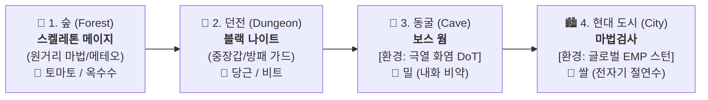

# 📜 Shards of Veyara - 밸런스 조정 및 마스터 사양서 종합 보고서
**Combat Balance Revision Master Changelog & Progression Specification**

---

## 1. 밸런스 조정 배경 및 목적

### 1.1 초기 문제점 (9월 4일 초보자 5인 실측 로그 기반)
* **전투 사망률 0.0%**: 5명 전원 숲/던전 보스를 1트라이 만에 클리어 (`MonsterDeaths = 0`).
* **포션 사용량 0개**: 피가 거의 깎이지 않아 전투 중 포션 사용 횟수가 0회 (`PotionUsage = 0`).
* **가드/패링 사용 0회**: 적의 공격력이 너무 낮아 방어 액션 없이 평타 연타만으로 프리패스.
* **농사/봉헌 시스템 무용지물**: 준비 없이 직진해도 게임이 클리어되어 거점 생활 콘텐츠의 존재 가치 상실.

### 1.2 핵심 개선 목표
1. **무준비 직진 돌파 원천 차단**: 농사/봉헌 없이 직행 시 보스전 승률 1~3% 수준으로 억제.
2. **"농사 ➡️ 연금술/봉헌 ➡️ 상위 돌파"의 선순환 확립**: 각 맵의 파밍 수확물이 플레이어의 생존 및 공격력 성장에 직결되도록 유기적 연계.
3. **액션 본연의 손맛 복원**: 보스의 강력한 패턴에 맞춰 회피, 방패 가드, 패링, 포션 복용 타이밍을 강제.

---

## 2. 4대 맵 마스터 진행 구조 & 보스 계보 (정식 확정)

---

## 3. 세부 밸런스 조정 내역 (Data Table Changes)

### 3.1 봉헌 시스템 개편 ([DT_TributeData.csv](file:///c:/Users/user/Documents/GitHub/ShardsOfVeyara/DataTable/DT_TributeData.csv))
* **인게임 C++ 메커니즘**: `ATribute::SuccessInsert` 시 플레이어의 기본 공격력에 `+10.0`씩 영구 누적 (`BaseAttack = 70 + Level * 10`).
* **1단계 숲 맵과의 정합성 완료**:
  * 기존 무작위 재료 요구에서 숲 맵 수확물인 **토마토(tomato)와 옥수수(corn)**로 1~3단계 요구 재료 개편.
  * **1단계**: 토마토 1개 (ATK 80)
  * **2단계**: 토마토 2개, 옥수수 2개 (ATK 90)
  * **3단계**: 토마토 3개, 옥수수 4개 (ATK 100)  
    👉 **총 토마토 6개 + 옥수수 6개 소모하여 공격력 70 ➡️ 100 달성!**

---

### 3.2 1단계: 숲 맵 (Forest Map) 밸런싱

#### ① 인카운터 및 드롭 테이블 ([DT_MapEncounterData.csv](file:///c:/Users/user/Documents/GitHub/ShardsOfVeyara/DataTable/DT_MapEncounterData.csv))
* **진행 경로**: 6시 시작섬 ➡️ 버섯(1) ➡️ 벌(1) ➡️ 쥐(1) ➡️ 뱀(1) ➡️ 슬라임(1) ➡️ **[기믹] 보스방 앞 펫 풀피 힐** ➡️ 스켈레톤 메이지.
* **총 골드**: 8개.
* **드롭**: `ForestEnemy` (토마토 씨앗 40%, 옥수수 씨앗 40%, 차원결정 50%) / `ForestKeyEnemy` (부유 마력 결정 100% 확정 1개) / `SkeletonMage` (차원결정 5~10개).
* **구슬 조각 보상**: 보스 드롭에서 제외하고, `APortalSpawner`가 보스 격퇴 후 보스룸 중앙에 `BP_DimensionMarble_0`을 연출 스폰.

#### ② 보스 스탯 조정 ([DT_CombatStats.csv](file:///c:/Users/user/Documents/GitHub/ShardsOfVeyara/DataTable/DT_CombatStats.csv))
* **스켈레톤 메이지 (`Boss_Dungeon_SkeletonMage`)**:
  * **체력(HP)**: `3,200.0`
  * **공격력(ATK)**: `105.0` (메테오 1.7배 = 178 가드불가, 장판 1.3배 = 136)
  * **방어력(DEF)**: `15.0` / **공격 주기**: `1.6초`

#### ③ 🌟 신규 기믹 1: 부유 마력 결정(Levitation Crystal) 기반 고장난 부유 플랫폼 수리 숏컷
* **배경 및 목적**: 고난도 공중 플랫포밍(점프 패드, 외나무다리 등)으로 인한 낙사 스트레스 해소 및 보스 재도전 쾌속 지원. 단순 열쇠가 아닌 '고장난 부유 플랫폼 수리' 컨셉 적용.
* **메커니즘**:
  1. 보스 성채 중앙 하늘섬 입구에 멈춰있는 고장난 부유 플랫폼 배치.
  2. 우회/도망치기 쉬운 잡몹(벌/슬라임 등)을 무시하고 직진하는 런스루 방지를 위해, 길목을 지키는 특정 정예 몬스터 3마리(`ForestKeyEnemy`) 지정.
  3. 지정 몬스터 처치 시 100% 확정 드롭되는 **`부유 마력 결정 (BP_LevitationCrystal) 3개`**를 모아 플랫폼에 주입 시 영구 수리/가동.
  4. 6시 시작섬에서 보스섬으로 5초 만에 안전 직통 연결.
* **효과**: 몬스터 스킵 유저는 결정 부족으로 숏컷 개방 불가 (사냥 필수화) / 2회차 보스 재도전 시 점프맵 건너뛰기 가능.

#### ④ 🌟 신규 기믹 2: 하늘섬 낙하 데미지 페널티 시스템 (`ApplyFallPenalty`)
* **메커니즘**: 공중 발판/다리에서 추락 시 리스폰되면서 **80 HP의 낙하 데미지 차감 + 최소 1 HP 보장(즉사 방지) + 체력바 UI 즉각 동기화 + 피격 연출**.
* **효과**: 무성의한 낙하 돌파를 억제하고 플랫포밍 긴장감과 집중도 극대화.

#### ⑤ 몬테카를로 1,000회 시뮬레이션 실측치
* **[무준비 직행] 봉헌 0단계 / 포션 0개**:
  * 초보자 완주율: **3.1%** (보스방 사망률 **96.9%** 💀)
* **[정석 준비] 봉헌 3단계 (ATK 100) / 하급 포션 4개**:
  * 초보자 완주율: **84.8%** (보스방 사망률 15.2%, 포션 1.0병 소모, 클리어 22.5초)
  * 일반 유저 완주율: **99.8%** (포션 0.1병 소모, 클리어 16.9초)

---

### 3.3 2단계: 던전 맵 (Dungeon Map) 밸런싱

#### ① 4대 기믹 방 & 인카운터 정밀 명세 ([DT_MapEncounterData.csv](file:///c:/Users/user/Documents/GitHub/ShardsOfVeyara/DataTable/DT_MapEncounterData.csv))
1. **1. 몬스터 방**: `Enemy_BaseMage` (EvilMage) 2마리 (제단 수호 마법 탄막)
2. **2. 미로 방**: `Enemy_BaseMimic` (ChestMonster) 3마리 + `Enemy_BaseMelee` (Rebirth 스포너) + 화염/가시 함정
   * **[특수 상자 (1회성)]**: **골드 20개 (GoldIngots) + 비트 씨앗 5개 + 당근 씨앗 5개 확정 지급**
3. **3. 다락문 점프맵**: `Enemy_BaseExploder` (Beholder 자폭) 1마리 + `Enemy_BaseTranspar` (Specter) 1마리 (골드 3개)
4. **4. 독극물 점프맵**: `Enemy_BaseTranspar` (Specter) 1마리 + `Enemy_BaseGuard` (Bishop 방패병) 2마리 (골드 2개)
5. **5. 심층 알현실 (보스룸)**: 4개 제단 활성화 시 문 개방 ➡️ **펫 풀피 힐** ➡️ `Boss_BlackKnight` (블랙 나이트)
* **총 골드**: 25개 (다락문 3 + 독극물 2 + 미로 상자 20)

#### ② 몬스터 및 보스 스탯 조정 ([DT_CombatStats.csv](file:///c:/Users/user/Documents/GitHub/ShardsOfVeyara/DataTable/DT_CombatStats.csv))
* **블랙 나이트 (`Boss_BlackKnight`)**:
  * 체력(HP): 8,500 ➡️ **4,800.0** (샌드백 타작 방지)
  * 공격력(ATK): 25.0 ➡️ **105.0** (SlashCombo 105, ChargeRush 147, LightningZap 84 가드불가)
  * 방어력(DEF): 30.0 ➡️ **25.0** / **공격 주기**: 2.2초 ➡️ **1.9초**
* **일반 몬스터 현실화**:
  * `Enemy_BaseMage` (EvilMage): HP 300, ATK 32.0, DEF 5.0
  * `Enemy_BaseMimic` (ChestMonster): HP 550, ATK 38.0, DEF 15.0
  * `Enemy_BaseGuard` (Bishop): HP 500, ATK 35.0, DEF 20.0 (가드 단단함)
  * `Enemy_BaseExploder` (Beholder): HP 160, ATK 45.0 (자폭 치명타)

#### ③ 몬테카를로 1,000회 시뮬레이션 실측치
* **[무준비 직행] 봉헌 0단계 / 포션 0개**:
  * 초보자 완주율: **0.7%** (보스방 사망률 **99.3%** 💀)
* **[숲 클리어 스펙] 봉헌 3단계 (ATK 100) / 하급 포션 4개**:
  * 초보자 완주율: **92.8%** (보스방 사망률 7.2%, 포션 1.4병 소모, 클리어 50.0초)
  * 일반 유저 완주율: **100.0%** (포션 0.1병 소모, 클리어 36.6초)
* **[던전 미로 파밍 & 봉헌 완료] 봉헌 5단계 (ATK 120) / 중급 포션 4개**:
  * 전 코호트 완주율: **100.0%** (포션 0.1병 소모, 35.2초 쾌속 돌파 🏆)
* **1회 완주 시 평균 보상 실측치**:
  * 골드 25개 / 차원의 구슬 1 확정 1개 / 비트 씨앗 17.0개 / 당근 씨앗 17.0개 / 차원 결정 19.5개

---

### 3.4 3~4단계: 동굴 및 도시 환경 기믹(Hazard) & 연금술 사양서

#### ① 3단계: 동굴 (Cave Map)
* **환경 기믹 (Hazard)**: **극열 화염 지속 피해** (초당 최대 HP 3.0% DoT + 이동속도 20% 감소).
* **무준비 시**: 진입 후 30~40초 만에 체력 고갈로 보스방 도달 전 사망 사출.
* **1회차 파밍**: 입구 몬스터 처치 ➡️ **밀 씨앗(`BP_Seed_Wheat`)** 획득 후 복귀.
* **연금술 포션**: **내화 비약 (`FireResistPotion`)** = `밀(Wheat) x 2 + 당근(Carrot) x 2`
  * 효과: **4분간 화염 DoT 100% 면역** 및 정상 이속 확보 ➡️ 보스 **보스 웜 (`BossWorm`)** 돌파!

#### ② 4단계: 현대 도시 (City Map)
* **환경 기믹 (Hazard)**: **글로벌 전자기 펄스 방전 (EMP)** (5초마다 맵 전체에 펄스 발생 ➡️ 0.8초 강제 경직/스턴).
* **무준비 시**: 적과 교전 중 경직으로 공격 캔슬 및 피격 누적으로 통과 불가능.
* **1회차 파밍**: 외곽 적 처치 ➡️ **쌀 씨앗(`BP_Seed_Rice`)** 획득 후 복귀.
* **연금술 포션**: **전자기 절연수 (`ShockResistPotion`)** = `쌀(Rice) x 2 + 비트(Beet) x 2`
  * 효과: **4분간 EMP 주기적 경직 100% 면역** + 방어력 버프 ➡️ 최종 보스 **마법검사 (`MagicSwordMan`)** 돌파!

---

## 4. 핵심 데이터 연동 매트릭스 총괄표

| 맵 단계 | 지역명 | 보스 | 몬스터 드롭 | 봉헌/포션 연동 | 환경 기믹 (Hazard) | 대응 물약 |
| :---: | :---: | :---: | :---: | :---: | :---: | :---: |
| **1단계** | **숲 (Forest)** | **스켈레톤 메이지** (HP 3,200 / ATK 105) | 토마토, 옥수수, 결정 | **봉헌 1~3단계** (ATK 70 ➡️ 100 달성) | 없음 (기초 전투 학습) | 기본 회복 포션 |
| **2단계** | **던전 (Dungeon)** | **블랙 나이트** (HP 4,800 / ATK 105) | 당근, 비트, 결정 (미로 상자 골드 20) | **봉헌 4~6단계** (ATK 100 ➡️ 130 달성) | 없음 (가드/패링 강요) | 중급 회복/활력 포션 |
| **3단계** | **동굴 (Cave)** | **보스 웜** (HP 5,500 / ATK 110 예정) | **밀 (Wheat)**, 호박, 결정 | 봉헌 7~10단계 | **극열 화염 DoT** (초당 3% HP 손실) | **내화 비약** (`밀 x 2 + 당근 x 2`) |
| **4단계** | **현대 도시 (City)** | **마법검사** (HP 7,800 / ATK 120 예정) | **쌀 (Rice)**, 수박, 결정 | 봉헌 11~14단계 | **글로벌 전자기장 EMP** (5초마다 0.8초 스턴) | **전자기 절연수** (`쌀 x 2 + 비트 x 2`) |

---

## 5. 공통 시스템 & UX/클리어 연출 개선 내역

### 5.1 체력바(HealthBar) UI 원형 캡슐 찌그러짐 방지 & Fill 투명도 분리 ([HealthBar.h](file:///c:/Users/user/Documents/GitHub/ShardsOfVeyara/Source/AGSD/HealthBar.h), [HealthBar.cpp](file:///c:/Users/user/Documents/GitHub/ShardsOfVeyara/Source/AGSD/HealthBar.cpp))
* **배경**: 프로그레스바 Scale 방식 사용 시 `0.032(3.2%)` 이하 빈사 구간에서 원형 게이지가 타원형으로 납작하게 찌그러지는 현상 발생. 또한 전체 위젯 Opacity 조절 시 배경 슬롯 이미지까지 흐려지거나 사라지는 문제.
* **해결책**:
  1. **원형 크기 고정 (Clamp)**: `MinCapsulePercent = 0.032f`로 최저 크기를 고정하여 원형 형태 영구 유지.
  2. **배경 틀(Background) 100% 보존**: 위젯 전체 `SetRenderOpacity`를 제거하고, 배경 슬롯은 항상 선명하게 유지.
  3. **게이지(Fill Image) 알파 분리 제어**: `HealthProgressBar->SetFillColorAndOpacity()`의 알파(`A`)만 조작하여, `0.032` 미만에서 빨간색 게이지만 부드럽게 페이드아웃 및 0 HP 시 깔끔하게 숨김.

### 5.2 보스 보상 중앙 스폰 및 포털 개방 시퀀서 ([PortalSpawner.h](file:///c:/Users/user/Documents/GitHub/ShardsOfVeyara/Source/AGSD/PortalSpawner.h), [PortalSpawner.cpp](file:///c:/Users/user/Documents/GitHub/ShardsOfVeyara/Source/AGSD/PortalSpawner.cpp))
* **배경**: 보스 처치 시 차원의 구슬 조각이 시체 밑에 떨어지거나 인벤토리에 자동 투입되는 밋밋한 연출 대신, 젤다/소울라이크 스타일의 보스룸 클리어 연출 확립.
* **해결책**:
  1. **중앙 스폰 포인트 (`RewardSpawnPoint`)**: 에디터에서 보스룸 한가운데 위치를 지정할 수 있는 타겟 컴포넌트 추가.
  2. **보스 격퇴 연출 (`SpawnRewardItem`)**: 보스 사망 시 연출 딜레이(`RewardSpawnDelay`, 1.5초) 후 보스룸 중앙에 구슬 조각(`BP_DimensionMarble_X`)을 스폰 (나이아가라 파티클 & 사운드 동시 재생).
  3. **F키 획득 연동 중앙 포털 개방 (`TriggerSpawnPortal`)**: 플레이어가 구슬을 F키로 획득하면 인벤토리 이벤트(`OnItemAdded`)를 감지하여 **구슬이 있던 바로 그 자리에 탈출 포털 소환**.
  4. **드롭 분리 및 1회성 보장**: `DT_EnemyItemDrop.csv` 보스 드롭에서 구슬을 분리하여 중복 획득 방지 및 던전 재도전 시 안전성 확보.

